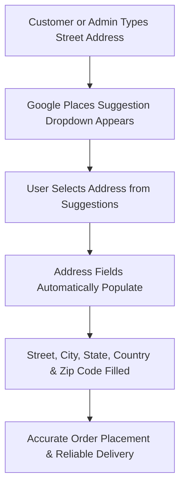

# Introduction

**Magento 2 Google Address Auto Complete (Webkul_GoogleAddressAutoComplete)** seamlessly integrates Google's powerful Places API into your Adobe Commerce and Magento 2 store. As customers or store administrators start typing a street address, the extension delivers instant, real-time address predictions and automatically populates the entire address form upon selection.

Address entry errors, incorrect postal codes, and misspelled city names are among the leading causes of failed shipments, customer support tickets, and abandoned carts. By reducing keystrokes and ensuring high data accuracy, this extension streamlines the purchasing journey from checkout to delivery.

---

## Why Address Autocomplete is Essential for eCommerce

* **Reduces Cart Abandonment:** A tedious, lengthy address form is one of the top friction points during checkout, especially on mobile devices. Fast, one-click address completion speeds up the buying cycle.
* **Eliminates Costly Shipping Errors:** Invalid street numbers, typo-ridden city names, and mismatched postal codes result in returned packages, rerouting carrier penalties, and lost customer trust. Google Places validates address integrity before order placement.
* **Enhances Customer Experience:** Shoppers enjoy an intuitive, modern autofill experience identical to leading global retail platforms.
* **Accelerates Admin Order Entry:** Store customer service and phone sales teams can rapidly capture orders in the Magento Admin panel without manual data entry fatigue.

---

## Key Features

* **Checkout Street Address Autocomplete:** Live suggestions for both Shipping and Billing address forms during checkout.
* **Customer Account Address Book:** Real-time address suggestions when customers add or edit entries in their account Address Book.
* **Admin Order Creation Autocomplete:** Empowers store administrators to auto-fill customer billing and shipping details while creating orders in the admin panel.
* **Admin Customer Profile Management:** Auto-populates addresses when creating or modifying customer profiles in the admin backend.
* **Admin Sales Order Address Edit:** Seamless address suggestion when modifying shipping or billing addresses of existing orders from the backend.
* **Database Address Caching:** Caches verified address results for faster, instant address suggestions on repeat searches.
* **Debounce & Search Threshold:** Configurable typing debounce delay and minimum search character threshold to optimize API traffic.
* **Active Country Restriction:** Option to restrict suggestions strictly to the selected country in the address form.
* **Google Places API Integration:** Powered by Google Places API for fast, reliable, and precise geocoding worldwide.
* **Intelligent Component Mapping:** Accurately maps street number, premise, route, sub-locality, locality/city, administrative area (state/province), country, and postal code.
* **Hyvä Theme Compatibility:** Fully compatible with modern Hyvä storefronts and standard Magento Luma themes.
* **Multi-Language & RTL Ready:** Supports standard Magento translation dictionaries (`i18n`), including Right-to-Left (RTL) Arabic and Left-to-Right (LTR) languages.

::: tip Next Steps
Proceed to the [Requirements](/requirements.html) guide to review prerequisites, or follow the [Installation](/installation.html) instructions to deploy the module.
:::
