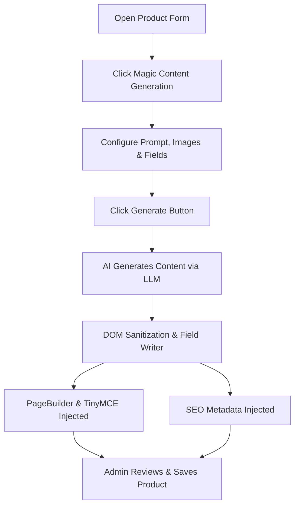

# AI-powered Magic Content Generator

The **AI-powered Magic Content Generator** is an advanced, multi-modal content creation tool integrated directly into the Magento 2 Admin Product Edit and New Product creation forms.

Unlike standard single-field AI generation buttons that populate one attribute at a time, the Magic Content Generator enables store administrators to define a comprehensive prompt, attach visual reference images, select multiple target catalog attributes, and generate synchronized, production-ready product copy in a single unified AI request.

---

## Key Highlights

* **Unified Multi-Attribute Generation**: Populate descriptions, short descriptions, SEO metadata (Meta Title, Meta Keywords, Meta Description), and custom eligible attributes all at once in a single round-trip.
* **Visual Context via Reference Images**: Upload up to 5 reference product images (JPG, PNG, WebP, GIF) to automatically extract rich metadata (EXIF/IPTC tags, image dimensions, descriptions) and feed visual context into the AI model.
* **Interactive In-Modal Configuration**: Live prompt character counter (up to 2,000 characters), interactive attribute selection chips (up to 10 attributes simultaneously), and real-time image thumbnail management with remove actions.
* **Enterprise-Grade HTML Sanitization**: Rich-text outputs (TinyMCE and PageBuilder) are processed through a strict DOM-level sanitizer (`\DOMDocument` + `\DOMXPath`) that eliminates malicious tags, inline JavaScript handlers (`on*`), and unsafe URL protocols while preserving clean e-commerce semantic markup (`
`, `<ul>`, `<li>`, `<strong>`, `<table>`, `<a>`).
* **PageBuilder & TinyMCE Stage Synchronization**: Built-in defensive field writing correctly resets and re-initializes PageBuilder stages and TinyMCE instances, guaranteeing that generated content is not lost or overwritten when saving the product form.
* **Safe In-Memory Injection**: Content is injected into the active form fields in memory without automatically saving the product entity to the database, giving administrators full preview and edit control before committing changes.

---

## Prerequisites & Configuration

Before utilizing the Magic Content Generator, verify that:

1. **Module License & Status**: The module is active and validated under **Stores** &rarr; **Configuration** &rarr; **Webkul** &rarr; **AI Content Generator** &rarr; **General Settings**.
2. **Allowed Attributes Allowlist**: The desired attributes are enabled in **Allowed Content Generation Attributes** (`allowed_attributes`).
   - If an attribute is omitted from this allowlist, it will not appear as an selectable option inside the Magic modal.
   - Eligible attributes include all standard text, textarea, and WYSIWYG/PageBuilder fields (`varchar` and `text` backend types) that are not restricted system identifiers.

::: tip Attribute Availability
For full configuration details on enabling attributes, see the [General Configuration Guide](/features/general-configuration.html#allowed-content-generation-attributes).
:::

---

## Step-by-Step Workflow

### 1. Launch the Magic Content Modal

1. Navigate to **Catalog** &rarr; **Products**.
2. Click **Add Product** or edit any existing catalog product.
3. In the top action toolbar, click the **Magic Content Generation** button.

The modal window will open with the prompt editor, reference image dropzone, and attribute selection chips.

---

### 2. Enter Your Product Prompt

In the **Describe your product** field, provide specific details, bullet points, key features, target audience, or branding guidelines for your product.

* **Character Limit**: The textarea accommodates up to **2,000 characters**.
* **Live Counter**: A live character counter displays your current length (e.g., `124 / 2000`).
* **Prompt Best Practice**: Be descriptive. Mention key specifications, materials, design highlights, warranty details, and intended use. The more context you supply, the more persuasive and tailored the AI output will be.

---

### 3. Add Visual Reference Images (Optional)

The modal includes an interactive drag-and-drop zone allowing you to attach reference product photos:

* **Capacity**: Upload up to **5 images**.
* **Supported Formats**: `.jpg`, `.jpeg`, `.png`, `.gif`, and `.webp`.
* **File Size**: Up to **5 MB** per image.
* **Thumbnail Previews**: Each uploaded image displays an interactive thumbnail with a quick-remove button (`x`), updating the image count in real time (e.g., `2 of 5 added`).
* **Metadata Extraction**: When submitted, the backend securely inspects the images using PHP `finfo` buffer verification, parses EXIF/IPTC metadata, dimensions, and image titles, safely incorporating these visual details into the AI prompt without any injection vulnerability.

---

### 4. Select Target Fields to Fill

Under **Fields to fill**, the modal displays clickable attribute chips corresponding to the attributes configured in your admin allowlist:

* **Selection Rules**: You must select **at least 1 attribute** and can select up to **10 attributes** at once.
* **Default Selections**: Standard catalog attributes (e.g., `Description`, `Short Description`, `Meta Title`, `Meta Keywords`, `Meta Description`) are pre-selected by default.
* **Custom Attributes**: Any eligible custom text or textarea attribute enabled in the allowlist will appear as a chip option.
* **Selected Counter**: Tracks selections dynamically (e.g., `4 of 5 selected`).

---

### 5. Generate and Review Content

1. Click the primary **Generate** button in the modal footer.
2. The modal displays a loading overlay (*"Generating content for X attribute(s)..."*) while the AI processes the request.

3. Upon completion:
   - The modal closes automatically.
   - A summary dialog confirms the results:
     - **Generated**: Lists all attributes that were successfully generated and injected into the form.
     - **Not Applied / Failed**: Notifies you if any attribute could not be populated or encountered an error.

---

### 6. Inspect and Save the Product

* **Form Fields Updated**:
  - **Description & Short Description**: If PageBuilder is active, the stage is safely rebuilt with clean semantic HTML. If TinyMCE is active, the editor instance is updated immediately.
  - **SEO Metadata**: `Meta Title`, `Meta Keywords`, and `Meta Description` in the Search Engine Optimization tab are populated with concise, plain-text SEO copy.
  - **Custom Attributes**: Relevant input fields across form fieldsets are automatically updated.

* **Manual Verification**: Review the generated content, make any desired manual revisions or style tweaks.
* **Save to Database**: Click Magento's standard **Save** button in the top header. The content will now be persisted to the database.

::: warning Form Not Automatically Saved
The Magic Content Generator intentionally updates form fields in memory only. It **never triggers an automatic product save**, ensuring you always have final editorial control over what enters your catalog.
:::

---

### 7. Storefront Display

Once saved, the AI-crafted descriptions immediately reflect on the frontend product detail page:

* **Short Description**: Displayed prominently in the product summary area next to the image gallery and buy box.

* **Detailed Description**: Rendered under the **Details** tab with preserved semantic formatting (paragraphs, bullet lists, emphasis, and tables).

---

## Technical Architecture & Security Safeguards

### 1. Robust PageBuilder & TinyMCE Synchronization
In Magento 2, PageBuilder elements maintain their own internal stage canvases. Simply updating a hidden textarea value causes PageBuilder to overwrite changes with stale stage data when the form is saved. 

The Magic Content Generator implements a specialized defensive field writer (`field-writer.js`) that:
* Detects whether PageBuilder is active on target fields.
* Safely destroys stale instances and releases internal component locks.
* Injects new HTML values into the component source.
* Re-initializes `initPageBuilder()`, ensuring the visual canvas accurately mirrors the AI content and serializes cleanly on product save.
* Dispatches change notifications to TinyMCE instances (`editor.setContent()` and `editor.nodeChanged()`).

### 2. Strict DOM-Level HTML Sanitization
To prevent Cross-Site Scripting (XSS) and broken frontend layouts:
* Rich-text content (`texteditor`, `pagebuilder`) is passed through a native `\DOMDocument` + `\DOMXPath` sanitizer in `Model/Magic/ContentGenerator.php`.
* **Disallowed Elements Purged**: Automatically deletes `<script>`, `<iframe>`, `<object>`, `<embed>`, `<form>`, `<style>`, `<link>`, and `<meta>` tags.
* **Event Handlers Stripped**: Strips all inline `on*` attributes (`onclick`, `onmouseover`, `onload`, `onerror`).
* **Inline CSS Removed**: Strips inline `style` attributes to eliminate layout disruption.
* **Safe Protocols Enforced**: `<a>` tags only permit `http`, `https`, `mailto`, or relative URLs (blocking `javascript:` and `data:` schemes) and automatically append `rel="noopener noreferrer"` for external targets.
* **Plain Text Fields**: All non-rich attributes (`meta_title`, `meta_keyword`, `meta_description`, and plain text inputs) are stripped of HTML tags, control characters, and excess whitespace.

### 3. Unified Service Layer
All requests route through `Model/Services/CombinedContentService.php` to the central `ContentGenerationService`:
* Compatible with all supported AI providers: **OpenAI**, **Google Gemini**, **Anthropic Claude**, **OpenRouter**, **DeepSeek**, **Cerebras**, and **Preconfigured AI Servers**.
* Incorporates the active Store View locale into prompt directives, ensuring content is generated in the appropriate language.
* Automatically handles API encryption, rate-limiting HTTP 429 retries, and unified logging.
