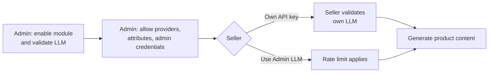

# Introduction

The **Magento 2 Marketplace AI Content Generator** (`Webkul_AIMpContentGenerator`) adds AI content generation to the Webkul Multi-Vendor Marketplace. Both the store admin and the marketplace sellers can generate product descriptions, short descriptions, and SEO meta content with a Large Language Model (LLM).

The admin connects one LLM provider for the whole marketplace. Each seller can then either connect their own LLM account or use the admin's connection, with a configurable request limit.

---

## Supported LLM Providers

| Provider | Composer package |
|---|---|
| OpenAI | `symfony/ai-open-ai-platform` |
| Gemini AI | `symfony/ai-gemini-platform` |
| Anthropic | `symfony/ai-anthropic-platform` |
| OpenRouter | `symfony/ai-open-router-platform` |
| Cerebras | `symfony/ai-cerebras-platform` |
| DeepSeek | `symfony/ai-deep-seek-platform` |
| Cohere AI | `symfony/ai-cohere-platform` |
| Mistral AI | `symfony/ai-mistral-platform` |

You install only the packages for the providers you plan to use. See [Installation](/installation.md).

---

## Key Features

### For the admin

* Choose an **LLM Provider** and **LLM Model**, set the **Temperature**, and validate the API key before saving.
* Let sellers use the admin LLM configuration when they have no credentials of their own.
* Limit how many requests per minute each seller can send through the admin credentials.
* Choose which product attributes AI may write, for both admin and sellers.
* Choose which LLM providers sellers can use.
* Generate content with **Fill with Marketplace AI** buttons on products, categories, CMS pages, and Page Builder HTML Code elements.
* Generate SEO meta content for products, categories, and CMS pages.
* Bulk-generate content from the product grid and the CMS page grid with the **Import AI Content** mass action.
* Create prompt templates, and view or edit the templates sellers create.
* Fill many product fields at once from a single prompt with **Magic Content Generation**.

### For sellers

* Connect their own LLM provider and API key from the seller account, or use the admin LLM configuration.
* Generate product descriptions, short descriptions, and SEO content on the product add and edit pages.
* Use **Magic Content Generation** to fill many product fields from one prompt.
* Bulk-generate content for selected products from the seller product list.
* Create their own prompt templates and use the templates the admin creates.

### For developers

* Two GraphQL queries let a headless storefront or seller app list the allowed attributes and generate product content. See [GraphQL API](/features/graphql.md).

---

## How It Works

---

## Need Help?

* Read [Troubleshooting](/help/troubleshooting.md) and the [FAQ](/help/faq.md).
* Contact [Webkul Support](https://store.webkul.com/support.html/).
