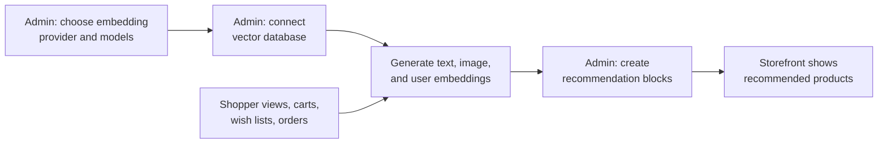

# Introduction

The **Magento 2 AI Product Recommendation** extension (`Webkul_AIProductRecommendation`) shows AI-powered product recommendations in your store. It turns product text and product images into **embeddings** (numeric vectors), stores them in a **vector database**, and finds similar products by comparing those vectors.

It also records what shoppers do — views, cart adds, wish list adds, compares, and orders — and uses that data for trending, recently viewed, and user-based recommendations.

This guide is for store admins and the developers who set up the server.

---

## In This Guide

1. **Getting Started** — [Introduction](/introduction.md), [Requirements](/requirements.md), [Installation](/installation.md), [Activation](/activation.md).
2. **Configuration** — [General Settings](/configuration/general-settings.md), [Vector Database Settings](/configuration/vector-database.md), [Manticore Search Setup](/configuration/manticore-setup.md).
3. **Embeddings** — [Generate Embeddings](/embeddings/generate.md), [Statistics](/embeddings/statistics.md).
4. **Recommendations** — [Manage Recommendations](/recommendations/manage.md), [Create a Recommendation](/recommendations/create.md), [Recommendation Types](/recommendations/types.md), [Storefront Results](/recommendations/storefront.md).
5. **Developers** — [REST API](/developers/rest-api.md).
6. **Help** — [Troubleshooting](/help/troubleshooting.md), [FAQ](/help/faq.md).

---

## Key Features

### Recommendation types

* **Trending** — most viewed, purchased, added to cart, added to wish list, or added to compare list.
* **Reviews** — top-rated products with a minimum number of approved reviews.
* **Category** — products from the current category.
* **User** — products liked by shoppers with a similar profile. Logged-in customers only.
* **Visual Similarity** — products that look like the current product, from image embeddings.
* **Text Similarity** — products with similar names and attributes, from text embeddings.
* **Recently Viewed** — products the shopper viewed recently.

See [Recommendation Types](/recommendations/types.md).

### For the admin

* Show each recommendation block on one or more pages: **Home**, **Category**, **Product Detail**, **Cart**, and **Order Confirmation**.
* Give each block a title, a product count, and a sort order.
* Schedule each block with a **Start Timing** and **End Timing**.
* Enable or disable blocks one at a time or in bulk.
* Limit recommended products by category, product, price range, low stock, product type, and visibility.
* Choose which product attributes go into the text embeddings.
* Validate the embedding models and the vector database connection before saving.
* Track the product image embedding queue on the **Statistics** page.

### Embedding providers

* **Pre Configured LLM** — HuggingFace (self-hosted), OpenAI, Gemini, Cohere, or Manticore built-in auto-embeddings.
* **LLM Provider** — OpenAI, OpenRouter, Gemini, Voyage, Mistral, or ONNX through the Symfony AI bridges.
* Separate image embedding models: Voyage Multimodal or a free, local ONNX model.

### Vector databases

* **Chroma DB**, **Milvus DB**, and **Manticore Search**.
* **OpenSearch** or **Elasticsearch**, when your store already uses that engine for catalog search.

### For developers

* Two REST endpoints return the recommendation blocks for a page and the recommended products for a block. See [REST API](/developers/rest-api.md).
* One CLI command creates text, image, user, and store embeddings. See [Generate Embeddings](/embeddings/generate.md).

---

## How It Works

1. Text embeddings are built from the product attributes you select. Image embeddings are built from the product images.
2. The vectors are stored in the vector database, one collection per store view.
3. When a page loads, each active recommendation block asks the vector database or the interaction data for matching products.
4. Saving a product updates its embeddings. An hourly cron job updates the user embeddings.

---

## Need Help?

* Read [Troubleshooting](/help/troubleshooting.md) and the [FAQ](/help/faq.md).
* Contact [Webkul Support](https://store.webkul.com/support.html/).
