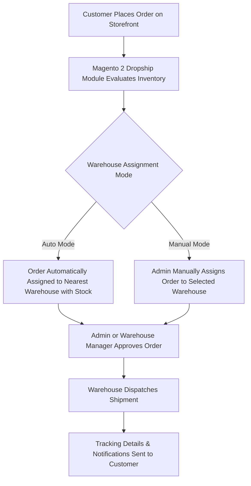

# Introduction

**Magento 2 Dropship Extension (Webkul_Dropship)** transforms your Adobe Commerce and Magento 2 store into a multi-warehouse, multi-source dropshipping ecosystem. By decoupling physical inventory storage from store administration, store owners can partner with regional suppliers and warehouses across different geographic locations, dramatically reducing overhead costs and optimizing shipping routes.

Whenever a customer purchases an item, the order is automatically routed to the nearest warehouse holding sufficient stock. The warehouse manager can then review the approved order, print packing slips, input courier tracking numbers, and fulfill the delivery directly to the end customer.

---

## Why Dropshipping with Magento 2?

* **Zero Upfront Inventory Risk:** Sell a vast catalog of products without the financial burden of purchasing, storing, and managing bulk physical inventory in a central warehouse.
* **Multi-Source Inventory (MSI) Concept:** Map individual products to multiple warehouses with warehouse-specific quantities and cost values. Supports Magento 2.3+ MSI sources and default stock mapping.
* **AliExpress Integration:** Import simple and configurable products directly from AliExpress using the dedicated AliExpress Importer Chrome extension, complete with variations, images, descriptions, reviews, and metadata.
* **Automated Order Processing:** When an AliExpress product is purchased in your store, administrators can auto-populate the customer's shipping address into the AliExpress checkout with a single click.
* **Custom Shipping Rates per Warehouse:** Each warehouse can specify distinct regional shipping table rates (via CSV upload) based on country, postal code ranges, product weight brackets, and flat fees.
* **Dedicated Warehouse Portals:** Provide warehouse managers with their own backend access to view sales statistics, manage assigned orders, generate packing slips, and enter tracking numbers.
* **Flexible Dataflow Profiles:** Import supplier catalogs in CSV, XML, or XLS formats with customizable attribute mapping and automatic price adjustment rules.

---

## Key Features at a Glance

| Feature Category | Highlights |
| :--- | :--- |
| **Warehouse Operations** | Create unlimited warehouses, assign physical origin locations, set allowed shipping carriers, and track inventory. |
| **AliExpress Importer** | Browser extension to scrape products, edit prices and variants prior to import, and sync price changes via cron. |
| **AliExpress Orders** | One-click redirect to AliExpress checkout with automated cart population and shipping address auto-fill. |
| **Shipping Rules** | Table rate shipping calculation based on warehouse origin and customer destination postal code/weight. |
| **Product Profiles** | Upload bulk inventory feeds (CSV/XML/XLS) with SKU match detection, image ZIP archives, and price hike rules. |
| **Dataflow Mapping** | Map proprietary supplier column headers to Magento product attributes without modifying original vendor files. |
| **Category Mapping** | Map supplier categories to native Magento catalog categories with attribute set association. |
| **Price Markup Rules** | Define percentage or fixed markup rules across price brackets to guarantee target profit margins. |

::: tip Next Steps
Review the [System Requirements](/requirements.html) to verify your environment, or proceed directly to [Installation](/installation.html) for setup instructions.
:::
