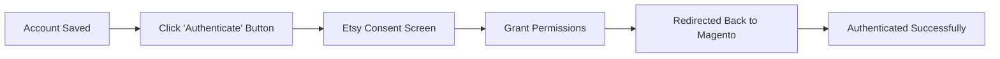

# Etsy Account Management

Connecting an Etsy shop to Magento allows you to synchronize catalog products, inventory levels, and customer orders. You can connect and manage Etsy shops either from the **Magento Admin Panel** or directly through the **Marketplace Seller Dashboard**.

---

## 1. Accessing the Accounts Manager

### Admin Panel Access
Navigate to **Marketplace Management → Marketplace Etsy Magento Connect → Etsy Accounts Manager**.
The grid displays all connected Etsy shops, their assigned marketplace sellers, shop IDs, authentication status, and creation timestamps.

### Seller Panel Access
From the storefront customer account, navigate to the **Marketplace Dashboard** and click **Etsy Connector** (`mpetsymagentoconnect/account/index`).


---

## 2. Adding a New Etsy Shop Account

Click the **Add Etsy Account** button (or **Add Account** in the seller panel) to open the registration form:


### General Account Information

| Field | Description |
|---|---|
| **Etsy Shop Name** | Enter your exact Etsy shop name (as shown in your Etsy URL: `etsy.com/shop/<shop-name>`). |
| **Seller** *(Admin only)* | Select which marketplace seller owns this Etsy account. Select `Admin` if connecting a store-owned shop. |
| **Attribute Set** | Choose the default Magento Attribute Set (e.g., `Default`) applied when creating new products imported from Etsy. |
| **Oauth Consumer Key & Secret** | *(Only required if Global Etsy App is set to "No")*. Enter your Etsy Developer App Keystring and Shared Secret. If Global App is enabled, these are handled automatically. |

### Shop Verification & Save
When you click **Save Etsy Account**:
1. Magento verifies that the shop exists on Etsy.
2. The account record is created and saved.
3. The edit screen reloads with the **Authenticate** button and additional configuration tabs (**General Settings**, **Product Sync**, **Order Sync**, **Export To Etsy**).

---

## 3. Authenticating the Account (OAuth 2.0 PKCE)

Once saved, the account is ready for secure authentication:



### Admin Authentication
On the **Etsy Account Info** tab, click the **Authenticate** button below the Attribute Set field:


### Seller Portal Authentication
For marketplace sellers authenticating from their dashboard, click the blue **Authenticate** button:


### Granting Permissions on Etsy
1. You will be redirected to the secure **Etsy Authorization** page.
2. Verify you are logged into the correct Etsy account and click **Grant Access**.
3. Etsy redirects your browser back to your Magento store:
   - **For Admin accounts**:
     ```text
     https://<your-store-domain>/<admin_frontname>/mpetsymagentoconnect/oauth/index/id/<account_id>
     ```
     *(e.g., `https://<your-store-domain>/admin/mpetsymagentoconnect/oauth/index/id/1`)*
   - **For Seller accounts**:
     ```text
     https://<your-store-domain>/mpetsymagentoconnect/oauth/index/
     ```
   > [!IMPORTANT]
   > Make sure this exact redirect URL is registered in the **Callback URLs** in your [Etsy Developer App](https://www.etsy.com/developers/your-apps). If there is a mismatch or missing ID parameter, Etsy will return an `invalid_redirect_uri` error.
4. Magento exchanges the authorization code for access and refresh tokens, securely saving them.
5. The account page refreshes with the status set to **Authenticated**.

---

## 4. Configuring Listing Defaults & Shipping Templates

After authentication, configure listing defaults for items exported to Etsy:


### Default Shipping Template
Etsy requires every listing to have an associated shipping profile:
- Select a **Default Shipping Template** from the dropdown (automatically fetched from your Etsy shop).
- All products exported from Magento will automatically use this shipping template.

### Export Products To Etsy As
- **Active Product**: Exported items become immediately active and purchasable on Etsy.
- **Draft Product**: Exported items are saved as drafts in your Etsy Shop Manager so you can review them before publishing.

### Mandatory Etsy Provenance Fields
Etsy requires three provenance attributes for every marketplace listing:

| Provenance Field | Options | Description |
|---|---|---|
| **Who made it?** | `I did`, `A member of my shop`, `Another company or person` | Identifies who produced the item. |
| **What is it?** | `A finished product`, `A supply or tool to make things` | Distinguishes finished merchandise from craft supplies. |
| **When was it made?** | `Made to order`, `2020-2026`, or vintage periods | Indicates when the item was manufactured. |

---

## 5. Account General Settings

Under the **General Settings** tab of the Etsy Account edit page, you can customize order import and product behavior specifically for this shop:


| Setting | Options | Description |
|---|---|---|
| **Default store view for order import** | Store Views dropdown | Select which Magento store view newly imported orders are assigned to. |
| **Etsy Imported Order Status** | Order Status dropdown | Set the initial order status for imported Etsy purchases (e.g., *Processing*, *Pending*). |
| **Default Website** | Websites dropdown | Select which Magento website imported Etsy products are assigned to. |
| **Product Import With Images** | `Yes` / `No` | When set to `Yes`, product images from Etsy listings are downloaded and assigned to Magento catalog items. |
| **Product Revision On Etsy** | `Yes` / `No` | When set to `Yes`, updates made to product price, stock, or details in Magento are automatically pushed to Etsy. |
| **Magento Product Delete On Etsy Map Record Delete** | `Yes` / `No` | When set to `Yes`, deleting an Etsy mapping record also deletes the product from Magento's catalog. Set to `No` to retain the Magento product. |

---

## 6. Automated Token Refresh

Etsy API access tokens expire after **1 hour** for security. The connector automatically manages renewal in the background:
- **Daily Auto-Refresh**: Background cron jobs automatically refresh expiring tokens once every 24 hours.
- **On-Demand Auto-Refresh**: If an operation occurs and a token is near expiration, the connector immediately renews it.
- Store owners and vendors do not need to re-authenticate manually under normal operation.

---

::: tip Next Step
Proceed to [Category Mapping](/configuration/category-mapping) to align Etsy taxonomies with Magento categories.
:::
