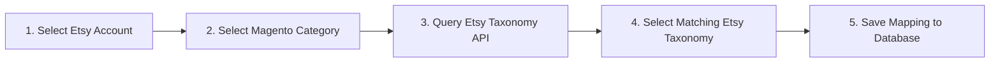

# Category Mapping

Etsy requires every product listing to be associated with an official **Etsy Taxonomy Node** (e.g., *Clothing → Men's Clothing → Shirts*). **Category Mapping** connects your Magento store categories with Etsy's taxonomies to ensure products exported to Etsy or imported into Magento land in the proper catalog classifications.

---

## 1. Accessing Category Mapping

### Admin Panel
Navigate to **Marketplace → Marketplace Etsy Magento Connect → Map Category**. The grid lists all active mappings showing:
- **Entity ID**: Unique mapping record ID.
- **Magento Category**: Name and path of the Magento category.
- **Etsy Category ID**: Standardized Etsy taxonomy ID.
- **Account / Store Name**: Associated Etsy shop.
- **Seller**: Assigned marketplace seller.

### Seller Panel
Sellers access mapping from their customer portal via **Marketplace Dashboard → Map Category**.

---

## 2. Mapping a Category

### Step 1: Select the Account
Choose which authenticated Etsy shop account you want to map. The system retrieves the seller's allowed catalog categories and queries Etsy's taxonomy tree.

### Step 2: Select Magento Category
In the interactive Magento category tree:
- Expand parent categories and check the desired target leaf or subcategory (e.g., `Default Category → Men → Tops → T-Shirts`).

### Step 3: Select Etsy Taxonomy
Using the Etsy category dropdown or cascading taxonomy selector:
- Browse Etsy's top-level categories and sub-taxonomies (e.g., `Clothing → Men's Clothing → Shirts & Tees → T-shirts`).
- The system resolves the specific numeric Etsy taxonomy ID (e.g., `1053`).

### Step 4: Save Mapping
Click the **Save** button. The link between your Magento category and the Etsy department is established and saved.

---

## 3. How Category Mapping Functions During Sync

### During Product Export (Magento → Etsy)
1. When you export a product to Etsy, the connector checks its assigned Magento category.
2. If mapped, the product is published on Etsy under the exact matching Etsy department (e.g., *Clothing → Men's Clothing → Shirts & Tees → T-shirts*).
3. If no mapping exists for the category, the system alerts you that category mapping is required before export.

### During Product Import (Etsy → Magento)
1. When importing a listing from Etsy, Magento checks the listing's Etsy department.
2. If a mapped category exists, the imported Magento product is automatically placed into that category.
3. If unmapped, the product is placed in your store's default category.
---

## 4. Managing & Updating Mappings

- **Update Mapping**: To change a mapped taxonomy, select the category mapping from the grid, pick the new Etsy category, and click Save.
- **Delete Mapping**: Select mapping records in the grid and use the **Actions → Delete** dropdown to remove outdated mappings.
- **Reset Grid**: If category changes occurred in Magento or Etsy, click **Reset Grid** to refresh cached taxonomy hierarchies.

::: tip Next Step
Learn how to import and export catalog items in [Product Synchronization](/configuration/product-sync).
:::
