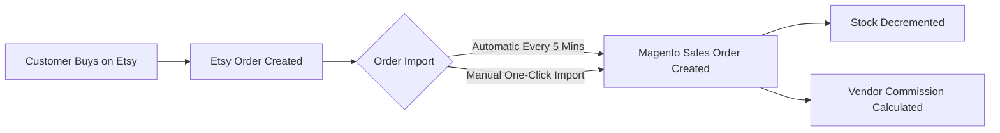

# Order Import & Shipping

The **Marketplace Etsy Connector** synchronizes customer orders placed on Etsy directly into your Magento 2 store, providing unified order fulfillment, inventory decrementing, and vendor commission tracking.

---

## 1. How Order Synchronization Works

Whenever a customer buys an item on your Etsy shop, the order information is transferred into Magento:

---

## 2. Order Synchronization Methods

Orders can be imported in two ways:

1. **Automated Background Sync**:
   - Runs automatically every **5 minutes** in the background.
   - Captures newly placed or updated Etsy orders without needing any manual button clicks.
   - Avoids duplicates by verifying existing synced Etsy order IDs.

2. **Manual On-Demand Import**:
   - Allows store owners and sellers to immediately pull orders from Etsy whenever needed.

---

## 3. Manual Order Import

To import orders manually:

- **Admin**: Go to **Marketplace Management → Etsy Accounts Manager → Edit Account → Order Sync tab**.
- **Seller**: Go to **Marketplace Dashboard → Import Order From Etsy** (`mpetsymagentoconnect/importorder/index`).

### Steps:
1. Click the orange **Import Order From Etsy** button.
2. The **Order Profiler** launches in an overlay modal with a progress bar.
3. Once completed, the imported orders populate the grid below, displaying the **Magento Order ID**, **Etsy Order ID**, and **Sync Date**.

---

## 4. Key Order Fulfillment Features

### Automatic Buyer Email Fallback
If an Etsy customer checks out with private email settings, Etsy may not provide their personal email address. The connector automatically creates a safe fallback email address (`buyer_{receipt_id}@etsy-customer.com`) so the Magento sales order is created smoothly without customer validation errors.

### Dedicated Etsy Shipping Method
* The connector applies a dedicated shipping carrier: **Marketplace Etsy Connector Shipping**.
* The shipping amount matches the exact delivery charge paid by the buyer on Etsy.

### Dedicated Etsy Payment Method
* Because the customer has already paid on Etsy, the order is assigned the **Payment From Marketplace Etsy** offline payment method.
* This marks the order as paid in Magento without attempting a second payment transaction.

### Vendor Commission & Payouts
* In multi-vendor environments, imported orders are immediately credited to the marketplace seller who owns the Etsy shop.
* Admin commissions and seller payout totals are calculated automatically based on your marketplace commission rules.

---

## 5. Reviewing Synced Orders

Both the administrator and individual sellers can review synced orders at any time:

* **Admin View**: Accessible directly on the **Order Sync** tab of each Etsy Account.
* **Seller View**: Accessible from **Marketplace Dashboard → Etsy Order History**.

The grid provides:
* **Magento Order ID**: Direct link to the full Magento sales order.
* **Etsy Order ID**: Reference to the original Etsy transaction.
* **Sync Date**: Timestamp of when the order was imported.

---

::: tip Next Step
Review complete version changes and updates in [Release Notes & Changelog](/configuration/changelog).
:::
