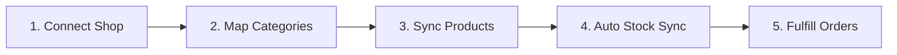

# Module Overview & Workflow

The **Webkul Marketplace Etsy Connector for Magento 2** allows store owners and marketplace sellers to connect their Etsy shops directly with their Magento 2 store. With this integration, you can manage products, track inventory, and process customer orders from a single, centralized dashboard.

---

## How It Works for Merchants

Managing both an online store and an Etsy shop is seamless with a simple 5-step workflow:

### 1. Connect Your Etsy Shop
* Add your Etsy shop name from either the Magento Admin Panel or the Marketplace Seller Dashboard.
* Authenticate your shop with a single click without sharing your Etsy account password.
* With the **Global Etsy App**, sellers can connect their shops instantly without having to create their own developer accounts.

### 2. Map Store Categories
* Match your Magento store categories to corresponding Etsy categories.
* Mapping ensures your products appear in the correct departments and browse categories when exported to Etsy.

### 3. Sync Products Between Platforms
* **Import from Etsy**: Download your existing Etsy listings into your Magento store, including product titles, descriptions, images, prices, and stock quantities.
* **Export to Etsy**: List your Magento simple and configurable products on Etsy as active or draft listings, including variations (like color and size) and shipping templates.

### 4. Automatic Price & Inventory Updates
* Whenever stock quantities or prices are adjusted in Magento, the changes are automatically updated on Etsy.
* This keeps your inventory accurate across both platforms and prevents overselling.

### 5. Centralized Order Fulfillment
* When a customer places an order on Etsy, it automatically appears in your Magento order list.
* Fulfill orders using your standard Magento shipping workflow while stock levels update automatically.
* Marketplace seller commissions and earnings are automatically calculated and recorded.

---

## Key Benefits

| Feature | What It Does for You |
|---|---|
| **Multi-Seller Management** | Both store administrators and approved marketplace sellers can connect and manage their own individual Etsy shops. |
| **Two-Way Product Sync** | Easily export Magento products to Etsy or import existing Etsy listings into Magento. |
| **Real-Time Stock Updates** | Prevents overselling by automatically reflecting inventory and price changes on Etsy. |
| **Automated Order Import** | Etsy orders are automatically imported into Magento for easy fulfillment and commission tracking. |
| **Simple One-Click Login** | Fast, secure authorization without needing technical credentials. |

---

::: tip Getting Started
Ready to connect your shop? Follow our step-by-step guide in [Etsy Account Management](/configuration/accounts).
:::

