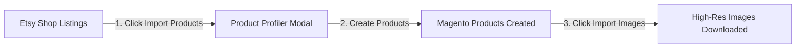

# Product Synchronization

The **Marketplace Etsy Connector** enables comprehensive two-way catalog synchronization between Magento 2 and Etsy. You can import active Etsy listings into your Magento store catalog or export Magento products directly to your Etsy shop.

---

## 1. Product Import (Etsy → Magento)

Importing products pulls active listings from your Etsy shop into Magento 2, staging them as native catalog products assigned to the corresponding marketplace seller.

### Accessing Product Import
- **Admin**: **Marketplace Management → Etsy Accounts Manager → Edit Account → Product Sync tab**.
- **Seller**: **Marketplace Dashboard → Import Product From Etsy** (`mpetsymagentoconnect/productimport/index`).

### How Product Import Works
1. Select the listing status to import (e.g., active listings).
2. Click the **Import Product From Etsy** button.
3. The **Product Profiler** launches in an overlay modal with a progress bar:
   - Fetches product details including **Title**, **Description**, **SKU**, **Price**, and **Stock Quantity**.
   - Associates the product with the mapped Magento category.
   - Assigns ownership to the marketplace seller.
4. Once product records are created, click **Import Product Images** to download high-resolution listing pictures into Magento's media catalog.

---

## 2. Product Export (Magento → Etsy)

Exporting products pushes Magento catalog items to your Etsy shop as either **Active** or **Draft** listings.

### Accessing Product Export
- **Admin**: **Marketplace Management → Etsy Accounts Manager → Edit Account → Export To Etsy tab**.
- **Seller**: **Marketplace Dashboard → Export Product To Etsy** (`mpetsymagentoconnect/productexport/index`).

### Export Workflow
1. The export grid lists all eligible Magento products with their ID, Name, Type, and SKU.
2. Select target products using individual checkboxes or the **Select All** mass-action option.
3. Select **Export To Etsy** from the **Actions** dropdown menu.
4. The system validates and exports each product:
   - Ensures the product category has been mapped in [Category Mapping](/configuration/category-mapping).
   - Applies the shop's default shipping template and mandatory provenance fields (maker, origin, date).
   - Uploads product images and creates the corresponding Etsy listing.

### Configurable Products & Variations
* When you export a **Configurable Product** (e.g., apparel with multiple sizes or colors), the connector creates an Etsy listing with corresponding **Variations**.
* Each simple child product maps to an Etsy option with its own price, SKU, and inventory count.

---

## 3. Real-Time Price & Inventory Synchronization

To prevent overselling and eliminate manual updating, the connector keeps Magento and Etsy in sync automatically:

* **Instant Updates on Save**: Whenever an administrator or vendor updates a mapped product's price, inventory quantity, or description in Magento, the revised details are pushed to Etsy in real time.
* **Bulk Import Parity**: If you update stock counts in bulk via Magento's standard CSV import tools, the updated inventory counts automatically sync across to your linked Etsy listings.

---

::: tip Next Step
Learn how incoming customer purchases are imported in [Order Import & Shipping](/configuration/order-sync).
:::
