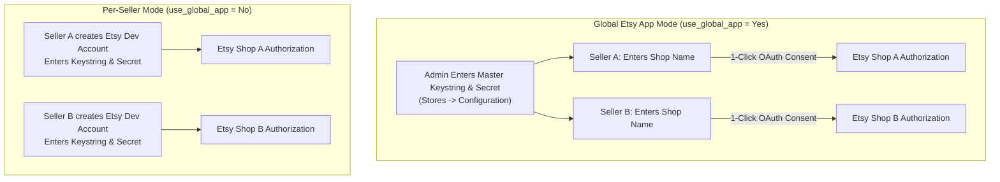

# Admin Settings & Global App

The administrative configuration controls the core behavior of the **Marketplace Etsy Connector**, including master module activation, the **Global Etsy App** credentials engine, default product assignment, and order synchronization parameters.

To access these settings, log into your Magento Admin Panel and navigate to:
**Stores → Configuration → Webkul → Marketplace Etsy Magento Connect**.

---

## 1. General Settings

The **General Settings** section governs extension activation and the shared OAuth application infrastructure.

| Setting | Options / Type | Default | Description |
|---|---|---|---|
| **Enable Marketplace Etsy Connector** | `Yes` / `No` | `No` | Master switch for the extension. When set to `No`, seller panel menus are hidden and synchronization stops. |
| **Use Etsy Global App Details For All Etsy Account** | `Yes` / `No` | `No` | When set to `Yes`, all Etsy accounts authenticate using the central application credentials specified below. Sellers only need their Etsy shop name and Etsy login. |
| **Oauth Consumer Key** | Text (Encrypted) | Empty | Your Etsy Developer Application **Keystring (Client ID)**. Only displayed and required if **Use Etsy Global App Details** is set to `Yes`. |
| **Oauth Consumer Secret** | Text (Encrypted) | Empty | Your Etsy Developer Application **Shared Secret**. Only displayed and required if **Use Etsy Global App Details** is set to `Yes`. |


---

## Understanding Global App vs. Per-Seller App



### Advantages of the Global App Mode
- **Zero Technical Friction**: Sellers don't have to navigate the Etsy Developer portal, apply for developer accounts, or configure redirect URLs.
- **Centralized Security**: Your API keys are encrypted and stored securely within Magento.
- **Single Developer App**: The store administrator maintains one approved Etsy application for the entire marketplace.

---

## 2. Default Settings For Import Etsy Orders

Controls how Etsy orders are provisioned within Magento:

- **Default store view for order import**: Select which store view newly created customer accounts and sales orders are assigned to.
- **Etsy Imported Order Status**: Define the initial order state for newly imported orders (e.g., `Processing`, `Pending`, or `Complete`).

---

## 3. Default Settings For Etsy Product

Establishes catalog defaults applied during product synchronization:

- **Default Website**: The Magento website assigned to products imported from Etsy.
- **Product Import With Images**:
  - `Yes`: Product media is queued in `marketplace_etsy_imported_images` and downloaded into Magento's `pub/media/catalog/product` repository.
  - `No`: Imports product textual and numerical attributes only, significantly reducing import duration for text-only updates.
- **Product Revision On Etsy**:
  - `Yes`: When a mapped product is updated and saved in the Magento backend, the `CatalogProductSaveAfter` observer immediately pushes the revisions (price, quantity, title, description) to the linked Etsy listing.
  - `No`: Disables automatic revision pushes.
- **Magento Product Delete On Etsy Map Record Delete**:
  - `Yes`: Deleting a mapping entry in `marketplace_etsy_product_map` also removes the corresponding product entity from Magento's catalog.
  - `No`: Keeps the Magento product in the catalog and only severs the synchronization link.

---

## 4. Product Information & Module License Tracker

The extension lifecycle, version tracking, and licensing status are managed via **Webkul Base**:

### Product Information
Located at the bottom of **Stores → Configuration → Webkul → Marketplace Etsy Magento Connect**:
- Displays the installed extension version (e.g., `5.0.2`).
- Provides direct links to the official Webkul User Guide and support ticket portal.

### Module License Tracker
To verify or update your module purchase license:
- Navigate to **Stores → Configuration → Webkul → Module License**.
- Locate **Marketplace Etsy Magento Connect** in the **Licensed Modules** table.
- Enter your License Key and click **Save & Verify** to authenticate the module.
- For complete step-by-step guidance and screenshots, see [Activate & Connect - License Key Verification](/activation#step-2-license-key-verification-module-license-tracker).

---

## Configuration CLI Commands

After updating configuration values via admin or deployment scripts, apply and flush caches:

```bash
# Clean configuration cache
php bin/magento cache:clean config

# If production mode is enabled, verify compiled DI
php bin/magento cache:flush
```

::: tip Next Step
Proceed to [Etsy Account Management](/configuration/accounts) to connect seller shops and complete the OAuth PKCE handshake.
:::
