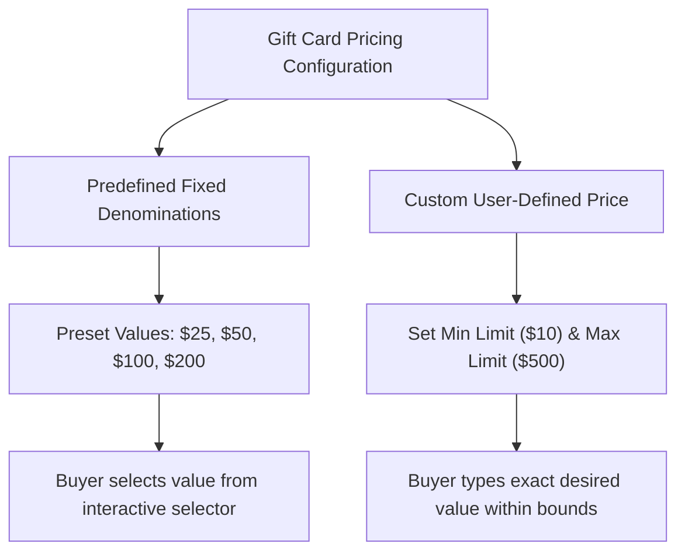

# Creating Gift Card Products

The **Magento 2 Gift Card** extension adds a dedicated product type named **Gift Card** (`wkgiftcard`) to the Magento Catalog. This allows administrators to create digital, physical, or combined gift card products with customized pricing options, card imagery, and delivery parameters.

---

## Step-by-Step Creation Guide

### 1. Add New Gift Card Product
1. Navigate to **Catalog > Products** in the Magento Admin panel.
2. In the top-right corner, click the arrow next to **Add Product** and select **Gift Card**.

---

### 2. Configure Product Attributes

Fill in the standard catalog attributes along with the extension's dedicated Gift Card fields:

| Field | Description | Setting Example |
| :--- | :--- | :--- |
| **Product Name** | Display title of the gift card product on catalog and search pages. | `Holiday Special Gift Card` |
| **SKU** | Unique stock keeping unit for inventory tracking. | `GC-HOLIDAY-001` |
| **Supported Delivery Methods** | Select supported delivery channels for the voucher (Email, SMS). | *Email, SMS* |
| **Validity in Days** | Number of days the gift voucher remains active after issuance. | `365` |
| **Price / Amounts** | Define fixed denomination values that customers can select from dropdown/radio choices (e.g., `$25`, `$50`, `$100`). | Add predefined amounts |
| **Allow Open Amount** | Enables shoppers to specify an arbitrary monetary value within defined minimum and maximum thresholds. | **Yes** / **No** |
| **Open Amount Min / Max Value** | Boundary limits for customer-entered values when open amount is allowed. | Min: `$10.00`, Max: `$500.00` |
| **Gift Card Templates / Designs** | Upload or select image templates representing seasonal card backgrounds (e.g., Birthday, Christmas, Corporate). | Image uploads |
| **Quantity & Stock Status** | Available stock inventory for the gift card product. | Set quantity & *In Stock* |
| **Tax Class** | Tax class applied during purchase (typically *None* for financial vouchers). | *None* |

---

## Pricing Modes Explained

::: tip Financial & Tax Best Practice
In many fiscal jurisdictions, purchasing a gift card is treated as a financial instrument exchange (an advance payment) rather than a taxable supply of goods. Therefore, the **Tax Class** for gift card products is commonly set to **None**. Sales taxes are assessed later when the recipient redeems the gift card to purchase taxable merchandise.
:::
