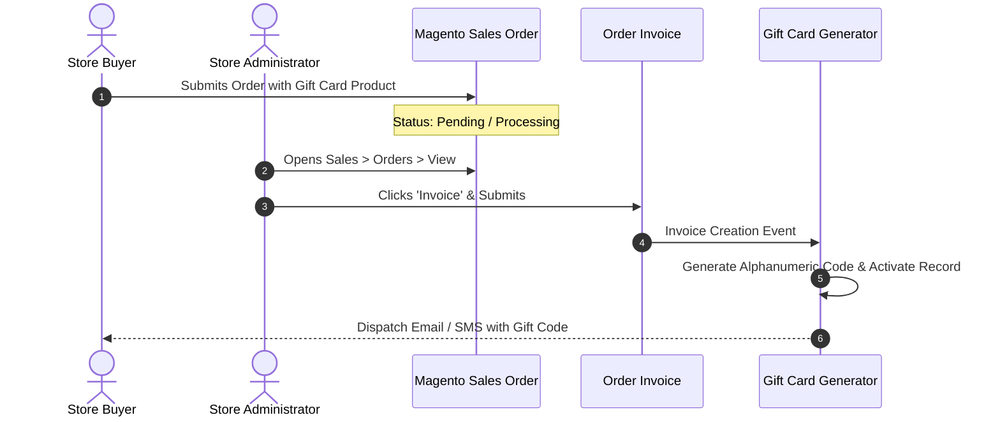

# Order Management & Invoicing

Managing orders that involve gift cards occurs seamlessly within the standard Magento Sales workflow. This page explains how order invoicing triggers code generation, and how discounts appear on orders placed using gift cards.

---

## Invoicing & Automated Code Generation

When an order containing a Gift Card product is paid and submitted by a customer, the voucher code is generated and dispatched **only after the invoice is created**.

::: warning Invoice Requirement
Gift cards are **not generated or dispatched** upon order placement alone. This safeguards the merchant against fraudulent orders and chargebacks by ensuring the code is created only after payment capture.
:::

---

## Viewing Orders with Applied Gift Card Discounts

When a shopper uses a gift card during checkout, the discount is deducted from the order subtotal (capped at subtotal) and tracked on the order records.

Navigate to **Sales > Orders** and open the order details:

### Order Details Highlights

1. **Order Totals Section:**
   - Displays the **Gift Card Discount** line item cleanly deducted from the subtotal.
   - Shows the exact voucher code used for the transaction.
2. **Invoices and Credit Memos:**
   - If an order with a gift card discount is refunded via Credit Memo, the refund calculation preserves the gift card credit appropriately.
