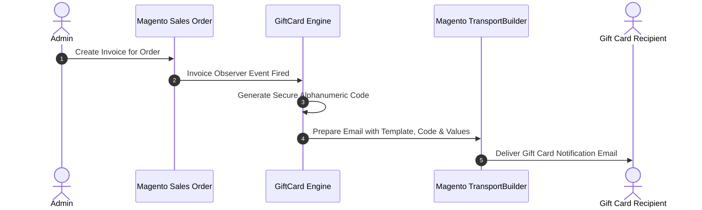

# Email & Notification Settings

The **Magento 2 Gift Card** extension features an automated transactional email system that notifies recipients when they receive a new gift card and alerts both the administrator and customer regarding remaining leftover balances.

Configure email preferences under:

**Stores > Configuration > Webkul > Gift Card**

---

## 1. Gift Card Email Setting (Recipient Notification)

When an order containing a gift card is invoiced by the administrator, the system dispatches an email notification containing the unique voucher code, monetary value, sender details, and personal message to the designated recipient.

| Setting | Description | Default Value |
| :--- | :--- | :--- |
| **Gift Notification Template** | Selects the transactional email template dispatched to the gift card recipient. | *Gift Card Notification (Default)* |

::: info Customizing the Email Template
To customize the visual layout, branding, and copy of the gift card email:
1. Navigate to **Marketing > Communications > Email Templates**.
2. Click **Add New Template**.
3. In the **Template** dropdown, choose `Gift Card Notification Template` and click **Load Template**.
4. Customize your template styles and HTML variables.
5. Save the template and select it under **Stores > Configuration > Webkul > Gift Card > Gift Card Email Setting**.
:::

---

## 2. Gift Card Left Amount Email Setting

When a customer redeems a portion of their gift card (partial redemption) and a balance remains, the extension can automatically alert both the administrator and customer about the leftover balance.

| Setting | Description | Example / Format |
| :--- | :--- | :--- |
| **Name of Admin in Mail** | Specifies the sender display name that appears in the leftover amount notification email. | `Customer Support` or `Sales Team` |
| **Admin Email** | The administrative email address receiving alerts when partial balances are used. | `sales@yourstore.com` |
| **Admin Left Amount Notification Template** | The transactional template used to format remaining balance notification emails. | *Admin Left Amount Notification (Default)* |

---

## Email Dispatch Architecture

---

## Sample Recipient Email Content

The recipient email delivers all relevant information required to redeem the voucher:

- **Sender Name:** The purchaser's full name.
- **Card Code:** The generated unique alphanumeric discount code (e.g., `1EIE5Z0TN8BZ5`).
- **Gift Amount:** The total credit amount allocated in store currency.
- **Personalized Message:** The greeting or message composed by the sender during purchase.
- **Expiry Information:** Expiration date calculated based on the configured active duration.
