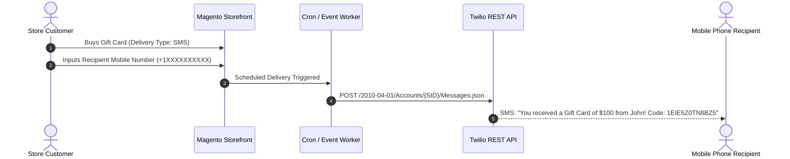

# SMS Configuration (Twilio Integration)

The **Magento 2 Gift Card** extension integrates natively with **Twilio**, allowing merchants to send gift card codes and recipient notifications directly via SMS text messages to mobile phone numbers globally.

Configure Twilio SMS settings under:

**Stores > Configuration > Webkul > Gift Card > Gift Card Text Message Setting**

---

## Twilio Credentials & Setup

To activate SMS notifications, obtain API credentials from your [Twilio Console](https://console.twilio.com/):

| Setting | Description | Required |
| :--- | :--- | :---: |
| **Twilio Account SID** | The unique Account Identifier (SID) assigned to your Twilio account. | **Yes** |
| **Twilio Auth Token** | The secure authentication token corresponding to your Account SID. | **Yes** |
| **Sender Mobile** | The Twilio-provided virtual phone number or verified sender ID that appears as the sender on the recipient's phone (in international E.164 format, e.g., `+12025550143`). | **Yes** |

::: warning Encrypted Storage
Both the **Twilio Account SID** and **Twilio Auth Token** use Magento's encrypted backend model (`Magento\Config\Model\Config\Backend\Encrypted`). They are encrypted using your installation's unique encryption key in `app/etc/env.php`, ensuring sensitive API tokens are never stored in plaintext within the database.
:::

---

## SMS Notification Workflow

---

## Requirements for Reliable SMS Delivery

1. **E.164 International Phone Format:** Recipient mobile numbers should include the appropriate country code (e.g., `+1` for USA, `+44` for UK, `+91` for India).
2. **Twilio Account Balance:** Ensure your Twilio account has adequate funds or credits to dispatch SMS messages to the target recipient countries.
3. **Geo-Permissions:** In your Twilio Console under **Messaging > Settings > Geo-Permissions**, confirm that the countries where your customers reside are enabled for SMS delivery.
