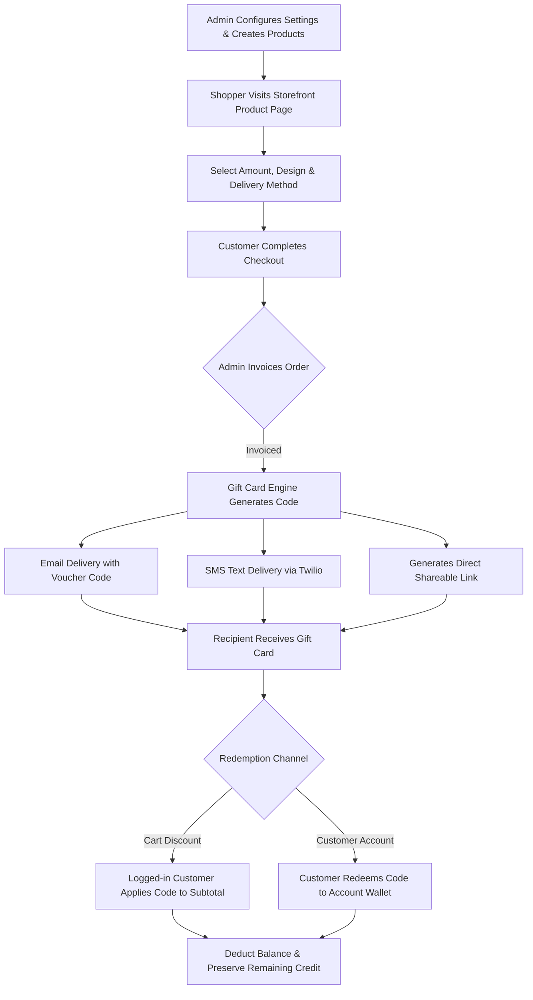

# Introduction

**Magento 2 Gift Card** extension empowers online store merchants to create, market, and manage digital gift cards directly inside Magento 2. Gift cards provide store owners with an effective channel to drive customer acquisition, boost customer loyalty, and capture prepaid revenue.

With this extension, store owners can set up gift cards with predefined monetary values, allow shoppers to specify custom price points, upload card imagery, personalize greetings, and schedule delivery dates across global timezones.

---

## Architecture & Lifecycle Workflow

The flowchart below illustrates how the Gift Card extension manages the end-to-end lifecycle between the Store Administrator and Storefront Customers:

---

## Critical Rules & Guardrails

::: warning Operational Rules & Restrictions
- **Single Voucher Application:** Only a single gift card code can be applied per purchase.
- **Subtotal Discount Capping:** Gift card discounts apply strictly against the order subtotal; shipping charges are not discounted.
- **Multi-Address Checkout Restriction:** Gift cards cannot be applied during multi-address checkout transactions.
- **Customer Login Requirement:** Shoppers must be logged in to their store account to apply gift card discounts in the cart.
- **Recipient Email Matching:** The customer account redeeming the voucher must match the recipient email specified during purchase (unless unassigned or shared).
- **Non-Refundable Policy:** Gift card products and redeemed voucher discounts are non-refundable on credit memos.
- **Invoicing Requirement:** Gift card voucher codes are generated and dispatched exclusively after the purchasing order has been invoiced.
:::

---

## Key Benefits of Magento 2 Gift Card

- **Drive Prepaid Revenue:** Gift cards provide guaranteed cash flow upfront while expanding brand reach to friends and family of existing customers.
- **Personalized Gifting Experience:** Buyers can select seasonal card designs, write custom messages, and specify recipient email addresses and phone numbers.
- **Precision Scheduling:** Automated background cron workers deliver notifications on the exact scheduled date and timezone selected by the purchaser.
- **Flexible Discount Application:** Shoppers can redeem gift cards in full or across multiple orders. Any remaining credit is automatically saved and tracked.
- **Multi-Channel Delivery:** Combines rich branded email templates, real-time SMS text messaging via Twilio, and direct shareable links.
- **Complete Admin Control:** Merchants have full visibility over active codes, order associations, allotted amounts, and expiration windows.
- **Headless & GraphQL Ready:** Built with native GraphQL support, enabling seamless integration with headless PWA storefronts and mobile applications.

---

## Core Extension Features

- **Dedicated Gift Card Product Type:** Create multiple virtual gift cards with fixed denominations or flexible customer-defined price ranges.
- **Validity Duration Control:** Configure custom validity lifetimes (in days) before issued gift cards expire.
- **Automated Delivery Engine:** Dispatches codes automatically to recipients via Email, SMS (Twilio), or generates a shareable web link.
- **Customer Account Management:** Storefront dashboard where customers view cumulative balances, check voucher statuses, redeem new codes, and share cards.
- **Left-Over Balance Notifications:** Automated email notifications sent to both admin and customer when partial balances are used.
- **Catalog Status Checker:** Inline status check widget on the gift card product page to verify code validity and unspent balances.
- **GraphQL API Support:** Provides native GraphQL API compatibility for mobile applications and headless storefront workflows.
