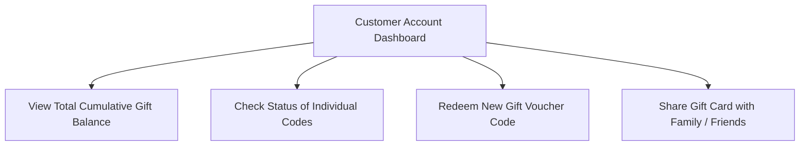

# Customer Account Dashboard

Registered customers have access to a dedicated **Gift Card** management section within their storefront customer account dashboard (`/customer/account/`).

---

## Customer Dashboard Features

When logged in, customers navigate to **My Account > Gift Card**:

### 1. Balance Summary & Active Vouchers Table

The dashboard displays a summary card showing the customer's total active gift balance along with a table of all cards associated with their email address:

| Column | Information Displayed |
| :--- | :--- |
| **Card Code** | Alphanumeric gift voucher code. |
| **Initial Amount** | Total original face value of the certificate. |
| **Remaining Balance** | Current unspent funds available. |
| **Status** | Active, Expired, or Used. |
| **Expiration Date** | Date and time when the code validity terminates. |
| **Currency** | Currency in which the balance is denominated. |

---

### 2. Redeem Gift Card to Account Wallet

Customers who receive a gift card code via email or physical voucher can redeem it directly into their account:

1. Under the **Redeem Gift Card** section, enter the code.
2. Click **Redeem**.
3. The voucher code is verified and linked to the customer's account. Its credit is added to their cumulative usable balance.
4. During future checkouts, the customer can apply credit directly from their account balance without needing to re-type the voucher code.

---

### 3. Sharing Gift Cards

Customers can also share or transfer their active gift cards to friends or relatives directly from their account dashboard by specifying the recipient's email address. Once shared, the system updates the certificate ownership and alerts the new recipient.
