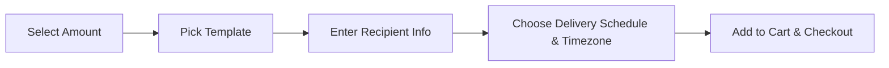

# Purchasing Gift Cards

Customers can browse and purchase gift cards directly on the storefront just like standard catalog products, with specialized interactive options for amounts, designs, and delivery scheduling.

---

## Storefront Product Page

When visiting a Gift Card product page, the shopper is presented with custom interactive configuration fields:

---

## Configuration Steps for the Customer

### 1. Select Card Value (Denomination)
- **Predefined Values:** The customer can click a preset amount button or select from a dropdown list (e.g., `$50`, `$100`, `$250`).
- **Custom Value:** If enabled by the administrator, an input field allows the buyer to enter any custom numeric amount within allowed minimum and maximum constraints.

---

### 2. Choose or Upload Card Design
The buyer can preview and select from pre-configured image templates (e.g., Birthday Celebration, Happy Holidays, Corporate). Furthermore, if the administrator enabled **Allow Custom Design** on the product, shoppers can upload their own custom image or artwork directly from their device.

---

### 3. Specify Delivery Channel & Recipient Information

| Delivery Channel | Required Fields |
| :--- | :--- |
| **Email Delivery** | Recipient Name, Recipient Email Address, Sender Name, Custom Greeting Message. |
| **SMS Delivery** | Recipient Name, Recipient Mobile Number (with country code), Sender Name, Custom Message. |
| **Share Link** | Recipient Name, Sender Name, Custom Message. Generates a shareable URL upon order invoicing that can be shared via messaging apps, WhatsApp, or email. |

---

### 4. Schedule Delivery Date & Timezone

Customers can choose between immediate dispatch upon payment or scheduling a future date:

- **Delivery Schedule:** Select **Send Later** to open the date picker.
- **Delivery Date:** Select the exact future date when the gift card should be sent.
- **Timezone:** Select the recipient's local timezone to guarantee the card arrives at the intended moment.

---

## Adding to Cart

Once configured, the buyer clicks **Add to Cart**. The mini-cart and cart summary display all custom details (recipient email/phone, delivery date, custom message) before proceeding to standard checkout.
