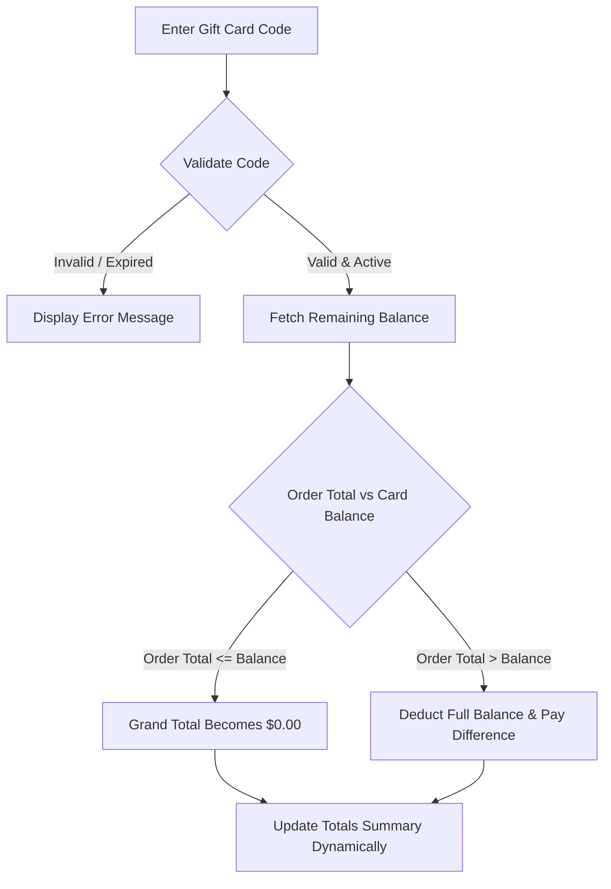

# Redeeming & Applying Discounts

Recipients can use their gift card code as an instant payment discount during checkout, or redeem the code into their digital customer account wallet.

---

## Applying Gift Card in Shopping Cart & Checkout

Shoppers can apply their gift card code in the Shopping Cart summary:

::: warning Customer Login Required
To access the **Gift Card Discount** block and apply gift vouchers in the cart, customers **must be logged in** to their store account. Guest visitors are prompted to sign in before redeeming vouchers.
:::

### Step-by-Step Cart Usage

1. Sign in to your customer account and add merchandise to the shopping cart.
2. In the cart totals summary, expand the **Gift Card Discount** block.
3. Enter the alphanumeric gift card code in the input field.
4. Enter the specific amount you wish to apply from the voucher (or up to the allowable cart subtotal).
5. Click **Apply**.

::: note Subtotal Capping & Single Voucher Policy
- **Subtotal Only:** Gift card discounts apply strictly against the order **subtotal**. Shipping and freight charges are not discounted by gift card credit.
- **Single Voucher Application:** Only **one** gift card code can be applied per order at a time.
:::

---

## Partial Redemption & Remaining Balance

A gift card can be used across multiple transactions until its monetary balance reaches zero:

- **Example:** A customer possesses a `$100` gift card and places an order totaling `$45`.
- **Deduction:** `$45` is deducted from the order, reducing the customer's payment balance to `$0.00`.
- **Remaining Balance:** The remaining `$55` is preserved under the voucher code and can be used on any future order.
- **Alert Notification:** The customer receives a leftover balance email notification confirming the unspent balance.

---

## Combining with Promotional Coupons

Gift cards function as a monetary payment tender rather than a promotional coupon code. This means customers can typically combine standard promotional coupon codes (such as percentage-off discounts or free shipping rules) with their gift card voucher on the same order.
