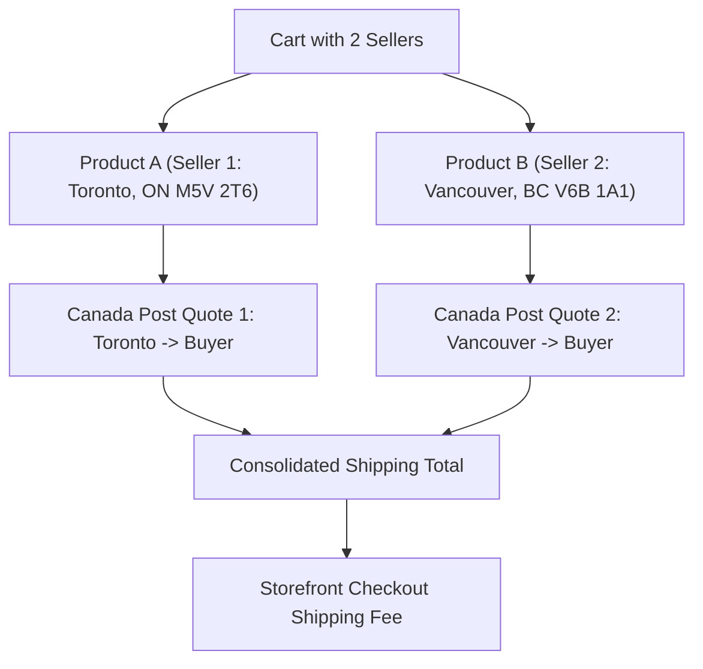

# Cart & Checkout Rates

Discover how customers interact with live Canada Post shipping rates on the storefront—from early shopping cart rate estimates to multi-vendor checkout and order reviews.

---

## 1. Shopping Cart Shipping Estimation

When shoppers add marketplace items to their cart, they can calculate real-time Canada Post shipping costs before proceeding to checkout:

1. Open the **Shopping Cart** page.
2. Expand the **Estimate Shipping and Tax** sidebar.
3. Select destination **Country** and enter the destination **Postal Code**.
4. The system sends an authenticated rating request to Canada Post using the seller's origin postal code and product weight.
5. Live Canada Post methods (e.g., *Expedited Parcel*, *Regular Parcel*, *Priority*) and pricing are displayed instantly.

---

## 2. Checkout Shipping Step & Delivery Estimates

During standard checkout:

1. The customer enters or selects their shipping address.
2. In the **Shipping Methods** section, all enabled Canada Post services appear with live prices.
3. If **Show Estimate Delivery Time** is enabled in admin settings, the calculated delivery date (incorporating the administrator's **Delivery Time Offset**) is shown alongside each method.

4. The customer chooses their preferred speed and cost (e.g., selecting *Xpresspost* for urgent orders or *Regular Parcel* for economical delivery).

---

## 3. Multi-Vendor Cart Rate Calculations

When a customer orders products sold by different marketplace sellers in a single checkout session:

* **Accurate Origin Routing:** Rates for Seller A's items are calculated from Seller A's warehouse postal code (e.g., Toronto `M5V 2T6`), while Seller B's items are calculated from Seller B's location (e.g., Vancouver `V6B 1A1`).
* **Independent Fulfillment:** When the order is placed, each seller fulfills their portion of the order and generates separate Canada Post shipping labels and tracking numbers.

---

## 4. Order Review & Confirmation

On the final checkout step, the buyer reviews their order summary, items, selected Canada Post delivery method, and combined totals before placing the order:

Upon order placement:
* The customer receives an order confirmation email showing the selected Canada Post service.
* Once the seller or store admin creates the shipment, the official Canada Post tracking number is emailed to the buyer and added to their storefront customer account under **My Orders**.
