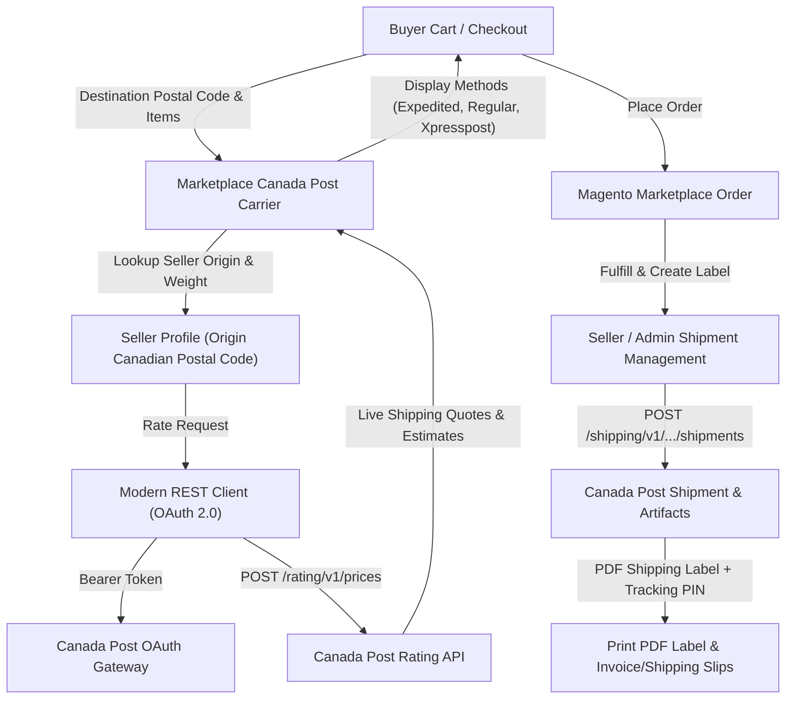

# Introduction

**Magento 2 Marketplace Canada Post Shipping** (`Webkul_MpCanadapostShipping`) integrates Canada Post's comprehensive parcel delivery services into your Adobe Commerce and Magento 2 Multi-Vendor Marketplace.

With this extension, marketplace sellers operating in Canada can provide real-time Canada Post domestic, USA, and international shipping rates to buyers at checkout. Shipping rates are dynamically calculated based on the **Seller's Origin Postal Code**, the **Product Weight and Dimensions**, and the **Buyer's Destination Address**. Furthermore, sellers and administrators can generate official Canada Post shipping labels, packaging slips, invoices, and tracking numbers directly from their store dashboards.

---

## Architectural Overview

The extension interacts directly with Canada Post's modern REST API platform using OAuth 2.0 authentication, ensuring fast rate queries and automated label generation:

---

## Core Features & Capabilities

- **Real-Time Dynamic Rates:** Calculates accurate shipping rates live from Canada Post servers at shopping cart and checkout stages.
- **Seller-Specific Origin Postal Codes:** Each marketplace seller can ship from their own Canadian location. Rates reflect the true distance from each vendor's warehouse to the customer.
- **Contract & Non-Contract Accounts:** Complete support for both commercial contract accounts (with pre-negotiated discount rates) and standard non-contract developer accounts.
- **Modern REST & OAuth 2.0 Architecture:** Built natively on Canada Post's current REST API infrastructure with cached OAuth 2.0 Bearer tokens for superior performance and reliability.
- **Automated PDF Shipping Labels:** Generate and download official Canada Post barcode shipping labels in PDF format for domestic, USA, and worldwide destinations.
- **Official Tracking PINs:** Automatically registers tracking PIN numbers on shipments and marketplace orders, allowing customers and vendors to track deliveries in real time.
- **Custom Packing & Invoice Slips:** Sellers can configure custom invoice and packing slip headers including business logos, tax numbers, and return addresses.
- **Bulk Date-Range Downloads:** Download consolidated PDF archives of invoices and shipping slips by custom date ranges.
- **Flexible Packaging Modes:** Supports dividing items into equal weight packages or utilizing Webkul packaging parameters with custom length, width, and height dimensions.
- **Handling Fees & Free Shipping:** Store administrators can configure custom handling fees (fixed amount or percentage) and free shipping subtotal thresholds.
- **Multilingual & Multi-Currency:** Compatible with multi-currency setups (CAD conversion), LTR/RTL layouts, and full multi-lingual localization.

---

::: tip Marketplace Add-on Notice
This extension is an add-on to the **[Webkul Magento 2 Multi Vendor Marketplace](https://store.webkul.com/magento2-multi-vendor-marketplace.html)** and depends on the **[Marketplace Base Shipping](https://store.webkul.com/magento2-marketplace-custom-shipping.html)** foundation module.
:::
