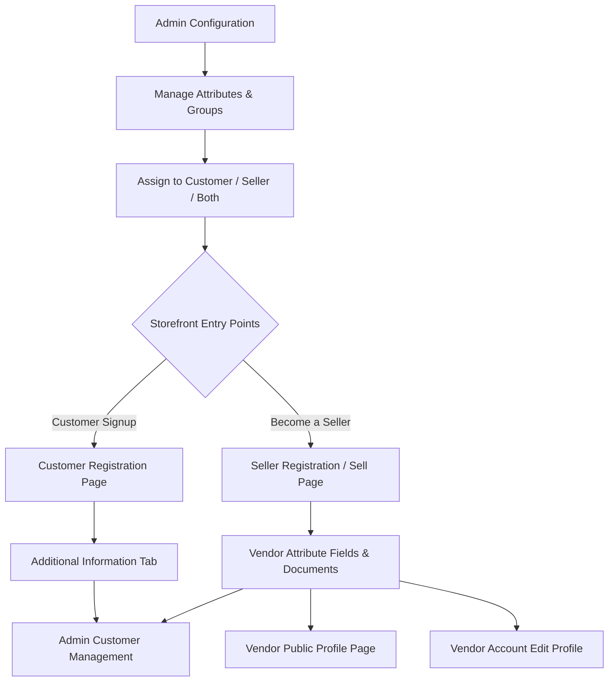

# Introduction

**Magento 2 Marketplace Vendor Attribute Manager** (Adobe Commerce) enables marketplace store owners to create custom registration fields and attributes for vendors and customers.

By default, Magento 2 and basic marketplace registrations only collect standard profile details such as name and email. With the Vendor Attribute Manager add-on, store administrators can capture vital business credentials—including tax registration numbers, company identity documents, certifications, website links, logos, and custom questionnaires—directly during registration or from vendor account dashboards.

The module integrates seamlessly with the **Webkul Magento 2 Multi Vendor Marketplace** core module, supports group-based attribute organization, interactive Terms & Conditions and Privacy Policy modals, and is compatible with multi-step marketplace onboarding layouts.

---

## Architectural Overview

The diagram below illustrates how custom attributes flow from administrative configuration to storefront registration, profile presentation, and backend customer management:

---

## Key Features

- **Custom Attribute Creation:** Create unlimited custom attributes with 8 distinct input types: Text Field, Text Area, Date, Yes/No, Dropdown, Multiple Select, Media Image, and File Attachment.
- **Flexible Assignment Targets:** Assign individual attributes specifically to **Customers**, **Sellers**, or **Both**.
- **Group-Wise Attribute Organization:** Organize related attributes into logical groups (e.g., *Company Details*, *Personal Information*, *Tax & Compliance*). Shoppers and sellers can select groups dynamically during registration.
- **Configurable Terms & Conditions:** Display custom Terms & Conditions and Privacy Policy popups with customizable button colors, header styles, and animation modes (Popup or Slide).
- **Public Vendor Profile Display:** Show selected vendor attributes, certifications, downloadable documents, and images on the public marketplace vendor profile page.
- **Multi-Step Seller Registration:** Full compatibility with Webkul Marketplace Landing Page Layouts (Layout 2 and Layout 3) for progressive multi-step vendor registration forms.
- **Admin Customer Management:** Store administrators can view and edit custom vendor and customer attribute values directly inside the Magento Admin customer edit panel (`Customers > All Customers`).
- **Input Validation Rules:** Built-in validation rules for text inputs including Alphanumeric, Numeric digits, URL, Email, and Letters.
- **Multilingual & RTL Support:** Fully compatible with multi-store locales, Left-to-Right (LTR), and Right-to-Left (RTL) storefront layouts.

---

::: tip Marketplace Add-on Requirement
This module is an add-on to **[Webkul Magento 2 Multi Vendor Marketplace](https://store.webkul.com/magento2-multi-vendor-marketplace.html)**. You must install the core marketplace module prior to installing and enabling the Marketplace Vendor Attribute Manager extension.
:::
