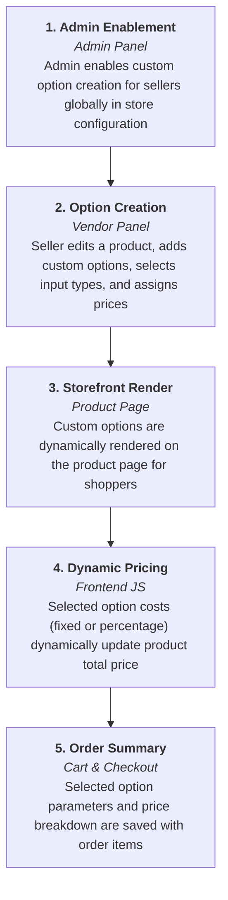

# Introduction

## Overview

The **Magento 2 Multi Vendor Custom Option** extension enables marketplace sellers to create and manage product custom options directly from their vendor panel. It brings Magento 2 native custom option capabilities into the multi-vendor ecosystem, giving sellers complete control over product personalization, input validation, dynamic pricing, and option ordering.

Whether selling customizable apparel, engraved gifts, custom-configured electronics, or downloadable file options, marketplace vendors can offer tailored options without requiring store administrator intervention.

---

### Custom Option Workflow

---

## Core Capabilities

- **Vendor Panel Autonomy:** Sellers add custom options to new or existing marketplace products.
- **Multiple Input Formats:**
  - *Text:* Field (single-line), Area (multi-line)
  - *File:* Customer File Upload
  - *Select:* Drop-Down, Radio Buttons, Checkbox, Multi-Select
  - *Date:* Date Picker, Date & Time, Time
- **Dynamic Pricing Models:** Absolute fixed dollar amounts ($) or percentage-based (%) price adjustments.
- **SKU & Validation Controls:** Option-level SKU suffixes and mandatory selection flags.
- **Drag-and-Drop Reordering:** Intuitive position sorting for options and option values.
- **Hyvä Theme Compatibility:** Native support for high-performance Hyvä storefronts.
- **Localization Ready:** Supports multi-language CSV translations and Right-to-Left (RTL) layouts.

---

## Key Benefits

- **Increased Average Order Value (AOV):** Up-sell premium customizations, warranty additions, and personalized extras.
- **Reduced Support Overheads:** Collect exact buyer specifications upfront via structured input fields.
- **Marketplace Seller Empowerment:** Gives sellers full flexibility to manage tailored products independently.
- **Seamless Storefront Checkout:** Clear display of chosen options in shopping carts and customer invoice receipts.

::: tip Next Steps
Proceed to the [Requirements](/requirements.html) page to review system prerequisites and Magento version compatibility.
:::
