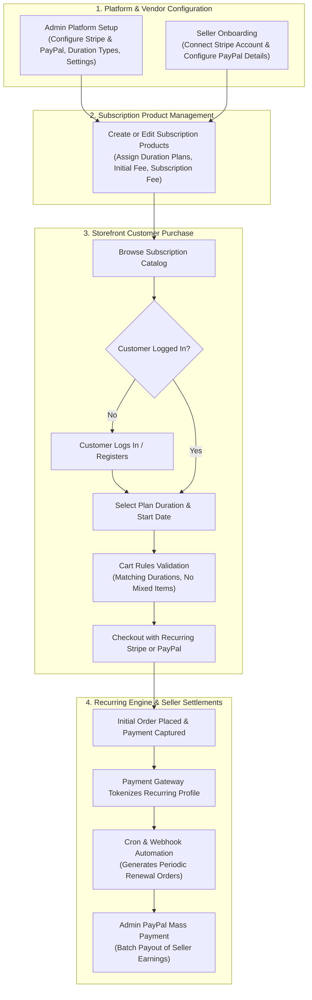

# Introduction

**Magento 2 Multi Vendor Recurring Payments & Subscription** transforms your marketplace into a recurring revenue engine by enabling both marketplace administrators and sellers to offer subscription-based products and automated billing services.

With this extension, merchants and sellers can define custom duration cycles (daily, weekly, monthly, quarterly, yearly), configure separate initial setup fees and recurring installment amounts, and accept automated renewals through online payment gateways (**Stripe** and **PayPal**) as well as offline payment methods.

::: tip Subscription Paradigm
Subscription models build predictable, recurring revenue streams, increase customer lifetime value (LTV), and foster long-term customer relationships with zero hassle on renewal dates.
:::

---

## Key Features

* **Multi-Vendor Subscription Enablement**: Both the marketplace store administrator and approved marketplace sellers can convert standard catalog products into recurring subscription offerings.
* **Flexible Duration & Frequency Types**: Define custom subscription terms such as daily, weekly, bi-weekly, monthly, quarterly, semi-annually, or yearly intervals.
* **Dual Pricing Tiers (Initial Fee + Subscription Amount)**: Set distinct initial onboarding fees alongside periodic renewal installment charges for every subscription plan.
* **Automated Recurring Billing**: Integrated with **PayPal Express Checkout Recurring** and **Stripe Connect Recurring** for automatic, scheduled card charges without customer re-authentication.
* **Offline Payment Support**: Supports offline payment processing for subscription orders where needed.
* **Multiple Subscriptions in Cart**: Option to allow multiple subscription products within a single checkout session (provided billing frequency and start dates align).
* **Multi-Product Type Compatibility**: Create subscriptions on **Simple**, **Configurable**, **Virtual**, and **Downloadable** product types.
* **Guest User Protection**: Guest customers are prompted to log in or register before subscribing, ensuring accurate account-level profile management.
* **Three-Way Cancellation Management**: Subscriptions can be reviewed and canceled at any time by the customer from their account portal, by the seller from the seller dashboard, or by the admin from the backend.
* **Automated Seller Payouts via PayPal Mass Payment**: Administrators can disburse vendor subscription earnings directly via built-in PayPal Payouts / Mass Payment functionality.
* **Real-Time Analytics & Reporting Dashboard**: Visual dashboards tracking subscription revenue, active subscribers, average subscription value (ASV), and churn rates.
* **Multilingual & RTL Support**: Fully localized with support for Arabic and other Right-to-Left (RTL) languages via CSV translation dictionaries.
* **Modern Stack Compatibility**: Compatible with **Hyvä Theme**, **Adobe Commerce (Cloud/EE)**, and standard Magento 2 Open Source editions.

---

## High-Level Workflow Architecture

