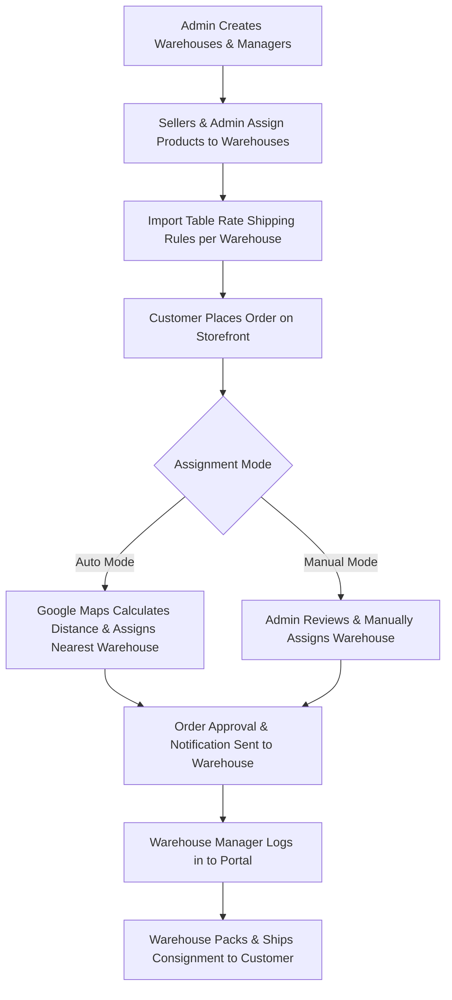

# Introduction

**Magento 2 Multi Vendor Dropship** extension allows the store administrator to create and manage multiple warehouses for marketplace sellers and the admin catalog. Using this module, marketplace sellers can easily allocate their inventory to various warehouses located across regions.

When a customer places an order on the storefront, the order is automatically routed to the nearest available warehouse based on the customer's shipping address using Google Maps Geocoding APIs, or assigned manually by the store administrator. Dedicated warehouse managers then have the authority to process orders, generate shipments, and dispatch packages directly to customers.

---

## Architecture & Dropship Workflow

The diagram below illustrates the end-to-end dropship fulfillment flow across Admin, Sellers, Warehouse Managers, and Storefront Customers:

---

## Key Features & Highlights

- **Multi-Warehouse Infrastructure:**
  - Create and manage unlimited warehouses with comprehensive contact, address, and credentials.
  - Set individual warehouses as **Active** or **Inactive** anytime with quick mass actions.
  - Automatically send new warehouse credentials via email upon registration.

- **Automated or Manual Warehouse Order Assignment:**
  - **Auto Assignment:** Leverages Google Maps Platform Geo-location APIs to identify the closest warehouse carrying the purchased items and automatically assign the order.
  - **Manual Assignment:** Admins review incoming vendor dropship orders and hand-assign the appropriate fulfillment warehouse.

- **Seller Dropship Capabilities:**
  - Seamlessly integrates with **Webkul Magento 2 Multi Vendor Marketplace**.
  - Marketplace sellers can assign their products to multiple warehouses directly from their frontend vendor dashboard.
  - Sellers specify custom stock quantities available at each designated warehouse.

- **Dedicated Warehouse Manager Portal:**
  - Warehouse managers receive secure login credentials to access a streamlined backend operations panel.
  - Warehouse managers can view assigned orders, track line items, generate shipments, and download packingslips.

- **Warehouse-Specific Table Rate Shipping:**
  - Upload CSV-based Table Rate shipping rules mapped to specific warehouses.
  - Define custom shipping costs based on Country, Region/State, City, Postal Codes, and Weight/Quantity conditions.
  - Warehouse managers can also import and maintain their own shipping rates.

- **Default Carrier Compatibility:**
  - Integrates smoothly with core Magento shipping methods:
    - **Table Rate Shipping**
    - **Free Shipping**
    - **DHL**
    - **UPS**
    - **USPS**
    - **FedEx**

- **Transactional Email Notifications:**
  - Welcome email notifying warehouse managers of new account creation and credentials.
  - Automated Order Approval alerts notifying warehouse managers when new orders require picking and fulfillment.
  - Configurable toggle to show or hide product pricing details in warehouse emails.

- **Address Auto-Complete:**
  - Integrated Google Places Address Autocomplete simplifies entering accurate warehouse addresses during setup.
