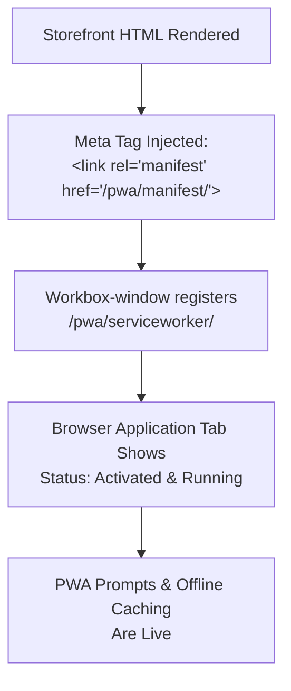

# Activation & License Registration

After completing the file installation and dependency setup, activate your extension license and enable the module in the Magento Admin Panel.

---

## 1. Webkul Module License Registration

The **Progressive Web Application** extension utilizes Webkul's license verification system:

1. Log in to your **Magento Admin Panel**.
2. Navigate to **Stores > Configuration > Webkul > Module License** (or **Webkul > Module License** from the main sidebar).
3. Locate **Progressive Web Application** (or `webkul_pwa`) in the extensions list.
4. Enter the **License Key** obtained from your Webkul account purchase confirmation.
5. Provide consent to the license agreement.
6. Click **Save Config**.


---

## 2. Enabling the PWA Module

1. Navigate to **Stores > Configuration > Webkul > Progressive Web Application**.
2. Under the **Settings** group, set **Status** to `Yes`.


3. Complete the Firebase credentials and branding fields (see [Firebase Setup](/firebase/credentials.html) and [Module Configuration](/admin/configuration.html) for detailed walkthroughs).
4. Click **Save Config**.
5. Flush the cache under **System > Tools > Cache Management**, or run the cache command in your terminal:

```bash:no-line-numbers
php bin/magento cache:flush
```
<ExplainCode explanation="Clears your store cache so that the PWA features and install prompts appear on your storefront right away." />


---

## 3. Verifying Storefront Activation

Once enabled and configured, verify that PWA features are actively running on your storefront:

### Verify Active Modules via CLI
Check that both the main PWA extension and Hyvä compatibility are turned on:

```bash:no-line-numbers
php bin/magento module:status Webkul_Pwa Webkul_PwaHyva
```
<ExplainCode explanation="Checks that both Webkul_Pwa and Webkul_PwaHyva are turned on and ready in your store." />

### Verify Manifest Endpoint via CLI
Check that your store's PWA app configuration is loading properly:

```bash:no-line-numbers
curl -I https://yourstore.com/pwa/manifest/
```
<ExplainCode explanation="Quickly checks that your store's PWA app settings file is loading correctly online (returns a 200 OK success code)." />

### Verify in Browser DevTools
1. Open your store URL (e.g., `https://yourstore.com/`) in Google Chrome.
2. Right-click anywhere and select **Inspect** to open Chrome DevTools.
3. Switch to the **Application** tab in DevTools:
   - **Manifest**: Click **Manifest** in the left sidebar. You should see your Application Name, Short Name, theme colors, and icons parsed from `/pwa/manifest/`.
   - **Service Workers**: Click **Service Workers**. You should see the active Service Worker registered from `/pwa/serviceworker/` with status `Activated and is running`.



::: tip HTTPS Validation
If DevTools displays a message indicating that the Service Worker failed to register, verify that your site is loading over a secure `https://` protocol and that no mixed-content HTTP requests are present.
:::
