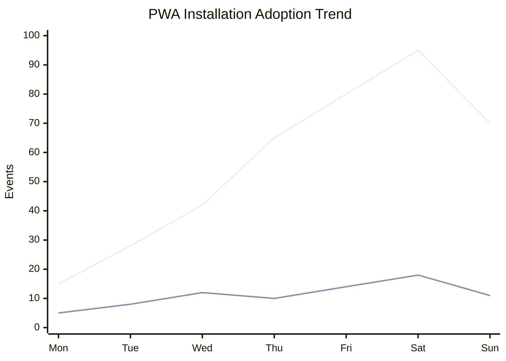

# PWA Download Analytics

The **PWA Analytics** dashboard provides store owners with clear, actionable insights into how customers adopt the Progressive Web Application on their devices.

Using interactive visual graphs powered by CanvasJS, administrators can monitor daily installation trends, user approvals, and prompt dismissals across various date ranges.

---

## Accessing PWA Analytics

1. In the Magento Admin sidebar, click **PWA**.
2. Select **Pwa Analytics**.

---

## Analytics Graph Breakdown

The analytics page displays a real-time dual-line trend chart:

* **Blue Solid Line (PWA Downloads)**: Tracks the number of shoppers who accepted the "Add to Home Screen" prompt and successfully installed the PWA app on their device.
* **Red Dotted Line (PWA Rejections)**: Tracks the number of shoppers who dismissed or rejected the installation prompt.

---

## Filtering Analytics by Date

To evaluate campaign performance over time:

1. Use the **From Date** and **To Date** calendar selectors at the top of the analytics dashboard.
2. Select the desired inspection interval:
   * **Single-Day Analysis**: View same-day installation metrics to evaluate real-time marketing push performance.
   * **Weekly / Monthly Analysis**: Evaluate long-term customer onboarding and adoption trends.
3. Click **Filter** to regenerate the CanvasJS report.

---

## How Tracking Works

The PWA module tracks customer interactions without invading user privacy:

1. When a customer visits the store in a compatible browser, the browser fires the standard `beforeinstallprompt` event.
2. If the customer taps **Add to Home Screen / Install**, the `userChoice.outcome === 'accepted'` callback sends an asynchronous ping to Magento's analytics controller, incrementing the **Download** counter for that day.
3. If the customer closes or dismisses the prompt, the `dismissed` outcome triggers a ping incrementing the **Rejection** counter.
4. Data is stored securely in Magento's `wk_pwa_analytics` database table for historical reporting.
