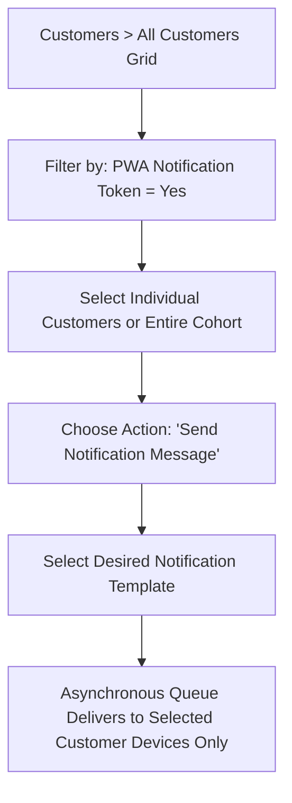

# Customer Grid Broadcast

Store administrators can target specific customers or customer segments with personalized push notifications directly from Magento's core **Customer Grid**.

This eliminates the limitation of only sending global broadcast messages to all subscribers, enabling targeted promotions, VIP exclusive offers, abandoned cart reminders, and order follow-ups.


---

## Customer Grid Enhancements

Navigate to **Customers > All Customers** in the Magento Admin Panel. The module adds two core capabilities:

1. **PWA Notification Token Column**:
   * A dedicated grid column indicating whether a customer has an active PWA subscription token (`Yes` or `No`).
   * Can be filtered or sorted to view only subscribers eligible to receive notifications.

2. **Send Notification Message Mass Action**:
   * A mass action dropdown option allowing administrators to send pre-configured notification templates to selected customer records.

---

## How to Send Targeted Customer Notifications

Follow these steps to send a push message to specific customers:

### 1. Filter Subscribed Customers
1. Go to **Customers > All Customers**.
2. Click **Filters**.
3. In the **PWA Notification Token** filter field, select **Yes**.
4. Click **Apply Filters**. The grid will now display only customers who have accepted push notification permissions on their mobile or desktop devices.



### 2. Select Customers & Trigger Action
1. Select the checkboxes next to the desired customers.
2. Click the **Actions** dropdown menu located in the top-left corner of the grid.
3. Select **Send Notification Message**.

### 3. Choose Notification Template & Dispatch
1. A dropdown displays all currently active notification templates created under **PWA > Manage Pwa Notifications**.
2. Select the campaign you want to transmit.
3. Confirm the action. Magento automatically matches the selected customer IDs to their registered Firebase device tokens and queues the delivery.

Ensure that the notification consumer is running to process the queued customer notifications:

```bash:no-line-numbers
php bin/magento queue:consumers:start webkul.pwa.notification_send &
```
<ExplainCode explanation="Runs the background helper process to send notification messages directly to your selected customers." />

---

## Best Practice Use Cases

* **VIP Customer Rewards**: Send exclusive early-access discount notifications to high-tier customers.
* **Re-engagement Campaigns**: Filter customers who haven't logged in recently and entice them back with special perks.
* **Customer Support Follow-ups**: Notify specific customers about resolutions or inventory restocks for items they inquired about.
