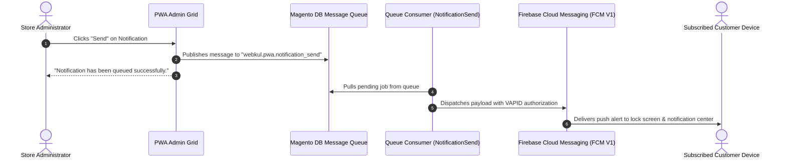

# Push Notifications Management

Store administrators can craft custom push notifications, broadcast announcements, promote flash discounts, and engage subscribed shoppers directly through the Magento Admin Panel.

---

## Accessing Notification Management

1. In the Magento Admin main sidebar, click the **PWA** menu item.
2. Select **Manage Pwa Notifications**.


---

## Push Notifications Grid

The notifications manager displays all previously created push campaigns:


### Grid Columns & Actions
* **ID**: Unique identifier of the notification campaign.
* **Title**: The bold header displayed in the device notification tray.
* **Message**: Body content of the notification describing the offer or update.
* **Target URL**: The destination web address opened when a customer taps the notification.
* **Notification Icon**: Thumbnail image displayed in the device notification card.
* **Status**: `Enabled` or `Disabled`.
* **Actions**:
  * **Edit**: Modify title, body, icon, or target destination.
  * **Delete**: Remove obsolete notification templates.
  * **Send**: Immediately queues and broadcasts the notification to all active subscribers.

---

## Creating a New Push Notification

To create a new push campaign:

1. Click the **Add Notification Message** button at the top right of the grid.


2. Fill in the required campaign details:

| Field Name | Description | Example |
| :--- | :--- | :--- |
| **Notification Title** | Headline text of the push notification (Keep concise, under 50 characters). | `Weekend Flash Sale! ⚡` |
| **Message Body** | Detailed promotional text or instructions. | `Enjoy 25% off all electronics until midnight. Use code FLASH25.` |
| **Target URL** | Full or relative URL to redirect the shopper upon tapping the notification. | `https://yourstore.com/deals.html` |
| **Notification Icon** | Square image displayed on the push alert (PNG or JPG recommended, 192x192 px). | `sale-badge.png` |
| **Status** | Set to `Enabled` to allow sending. | `Enabled` |

3. Click **Save Notification**.

---

## Sending Push Notifications

Once saved, locate your campaign in the grid and click **Send** in the Actions column:



1. Magento publishes the notification payload to the `webkul.pwa.notification_send` message broker.
2. The asynchronous consumer process (`NotificationMessageSendConsumer`) batches registered device tokens.
3. The consumer authenticates with the Google FCM V1 HTTP API via `google/auth` and transmits encrypted push frames (`minishlink/web-push`).
4. Notifications appear in real-time across subscribed Android devices, iOS home screen apps, and desktop browsers.

::: tip Asynchronous Processing
Because delivery runs through Magento's background message queue, administrators experience zero timeout delays or browser freeze when sending notifications to thousands of subscribers.

Ensure the queue consumer worker is active on your server:
```bash:no-line-numbers
php bin/magento queue:consumers:start webkul.pwa.notification_send &
```
<ExplainCode explanation="Runs the background helper that delivers your push notification messages to shoppers without slowing down your store." />
:::
