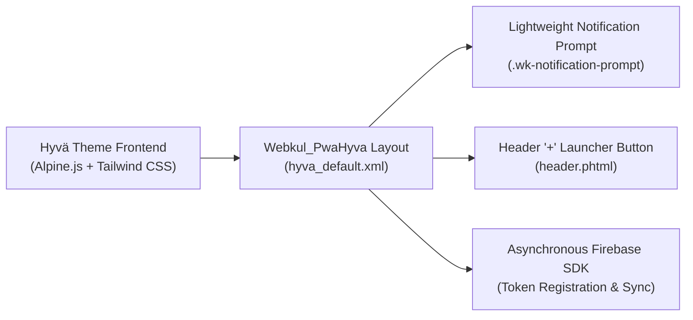

# Hyvä Theme Support

The **Webkul Pwa Hyvä** compatibility package (`Webkul_PwaHyva`) brings the Progressive Web Application into complete harmony with **Hyvä Themes**.

By eliminating legacy Magento Luma dependencies (such as RequireJS and jQuery) in favor of **Alpine.js** and utility-first **Tailwind CSS**, the module ensures maximum performance and perfect Core Web Vitals scores.

---

## Architecture & Benefits on Hyvä

* **Ultra-Lightweight Footprint**: Uses modular vanilla JavaScript and Alpine.js, preventing bundle bloat.
* **Non-Blocking Asset Loading**: Firebase SDK modules (`firebase-app.js`, `firebase-messaging.js`, `firebase-analytics.js`) are loaded asynchronously.
* **Tailwind CSS & Mobile-First Prompts**: Clean, responsive notification opt-in cards and install triggers that blend naturally with Hyvä themes.
* **Tested & Verified**: Fully verified and compatible with live Hyvä storefront environments.



---

## Verifying Hyvä Compatibility

To verify that the Hyvä compatibility module is properly loaded in your store:

1. Check module status:
   ```bash:no-line-numbers
   php bin/magento module:status Webkul_PwaHyva
   ```
   <ExplainCode explanation="Checks that the Hyvä compatibility package is active in your Magento store." />

2. Inspect the HTTP response headers of your live site:
   ```bash:no-line-numbers
   curl -I https://yourstore.com/
   ```
   <ExplainCode explanation="Verifies that your live website is running smoothly with Hyvä Themes." />

   Look for the Hyvä signature:
   ```http
   x-built-with: Hyva Themes
   ```

3. Confirm that `pwa-style.css` and Firebase scripts are loaded without console warnings.

4. If templates or theme styles require refreshing, republish design files and clear cache:
   ```bash:no-line-numbers
   php bin/magento setup:static-content:deploy -f
   ```
   <ExplainCode explanation="Refreshes your store design files, icons, and buttons for the Hyvä theme." />

   ```bash:no-line-numbers
   php bin/magento cache:flush
   ```
   <ExplainCode explanation="Clears your store cache so any visual updates show up on your Hyvä storefront immediately." />
