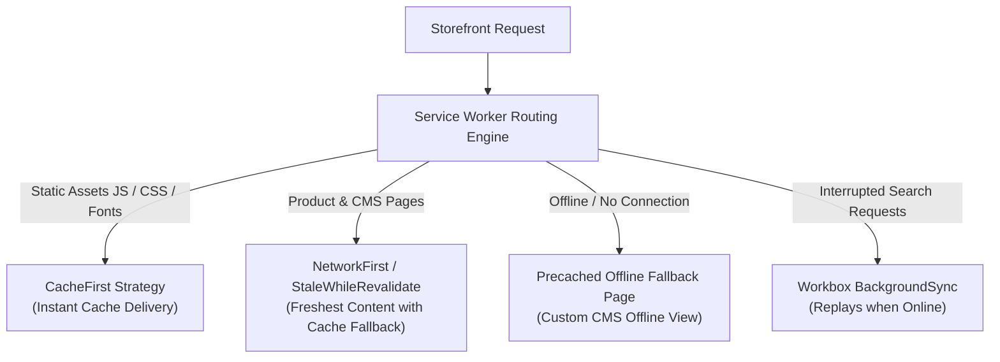

# Offline Browsing & Workbox Caching

The **Magento 2 Progressive Web Application** module is powered by Google's **Workbox (v5.1.2)** service worker library, providing enterprise-grade caching, offline resilience, and network fallback strategies.

---

## Caching Architecture Overview

When a customer loads your store for the first time, the service worker precaches critical assets and dynamically registers runtime caches:



---

## 1. Workbox Cache Strategies

### CacheFirst Strategy for Static Media & Assets
Images, fonts, stylesheets, and compiled JavaScript are served using **CacheFirst**:
* Assets are pulled instantly from the browser's Cache Storage without waiting for round-trip server responses.
* The module uses `CacheableResponsePlugin` with HTTP status `200` to prevent caching corrupted or partial responses.

### Precached Offline Fallback
* `workbox.precaching.precacheAndRoute` caches the custom CMS offline page and `manifest.json` during the service worker installation phase.
* If a shopper loses connectivity and navigates to an uncached page (such as search or checkout), the service worker's `setCatchHandler` serves the precached offline CMS page rather than a broken browser network error.

---

## 2. Workbox Background Sync

Network interruptions are common on mobile devices moving between Wi-Fi and cellular towers:

* **Background Sync Plugin (`workbox-background-sync`)**:
  * Automatically intercepts failed requests (e.g., catalog search queries or form submissions).
  * Enqueues the request in IndexedDB storage.
  * Listens for the browser's `sync` event and automatically replays the enqueued request as soon as network connectivity is restored.

---

## 3. Cache Expiration & Storage Sanitation

Unconstrained caching can fill up a shopper's mobile device storage. The module utilizes the **Cache Expiration Plugin (`workbox-expiration`)**:

* **Max Entries**: Limits the total number of items stored in runtime caches.
* **Max Age**: Automatically purges stale cached items after an expiration window.

---

## 4. Service Worker Cache Busting & Versioning

Cache names are versioned according to the **Service Worker Version** set in Magento Admin:

```javascript
// Generated in service worker
workbox.core.setCacheNameDetails({
    prefix: 'workbox-cache',
    precache: 'precache',
    suffix: `v${version}`,
});
```

Whenever you make major design updates or change site banners:
1. Navigate to **Stores > Configuration > Webkul > Progressive Web Application**.
2. Increment the **Service Worker Version** field (for example, from `1.0.4` to `1.0.5`).
3. Click **Save Config** and clear the Magento cache:

```bash:no-line-numbers
php bin/magento cache:flush
```
<ExplainCode explanation="Clears your store cache so shoppers automatically receive the latest version of your app and design updates on their next visit." />

4. Customer phones and browsers will automatically download the updated version the next time they open the app.
