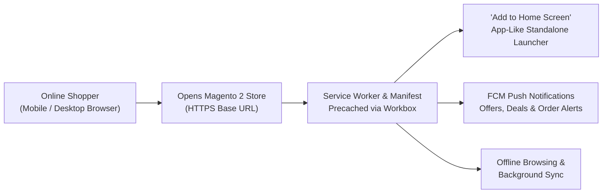

# Introduction

**Magento 2 Progressive Web Application (PWA)** transforms your standard Magento 2 store into an ultra-fast, mobile-first, app-like experience directly from the web browser.

By utilizing modern browser capabilities—including **Service Workers**, the **Web App Manifest**, **Cache Storage API**, and **Push API**—PWA delivers instant page loads, offline navigation, and push notifications without requiring users to download an application from the Google Play Store or Apple App Store.

---

## Why Progressive Web Applications?

Traditional native mobile apps face significant friction: users must search an app store, wait for a multi-megabyte download, accept permissions, and periodically install updates. Research indicates that native mobile apps lose up to **20% of potential users at every step** of the onboarding funnel.

A Progressive Web Application eliminates these barriers:
- **Zero Friction**: Shoppers access the PWA directly via standard URLs on Android Chrome, Opera, and iOS Safari.
- **Instant Installation**: Shoppers can install the application to their home screen with a single tap.
- **Lightning Fast**: Built-in **Workbox** caching strategies deliver near-instantaneous navigation, even on 2G/3G networks.
- **High Conversion Rates**: Prominent brands (such as Flipkart and Twitter Lite) reported dramatic boosts in conversions, session duration, and re-engagement after adopting PWA.

---

## Key Features

- **App-Like User Experience**: Launches in fullscreen or standalone display modes without browser address bars, complete with custom splash screens and app launcher icons.
- **Web Push Notifications**: Send promotional campaigns, flash sales, and automated order status notifications via **Firebase Cloud Messaging (FCM V1 API)**.
- **Android & iOS Compatibility**: Full web push notification and home screen installation support on Android (Chrome/Opera) and iOS Safari (iOS 16.4+).
- **Workbox Caching Strategies**: Intelligent runtime caching, precached offline pages, and **Workbox Background Sync** for network resilience.
- **Admin Push Notification Manager**: Create, schedule, preview, and trigger push notifications directly from the Magento Admin backend.
- **Customer Grid Mass Notifications**: View customer PWA token statuses and send targeted push notifications to selected customers from the standard **Customers > All Customers** grid.
- **PWA Download & Rejection Analytics**: Visual CanvasJS charts tracking daily PWA installation approvals and rejections.
- **Custom App Branding**: Admin-configurable application names, short names, theme colors, splash screen background colors, and device orientation locks.
- **Dedicated Hyvä Theme Compatibility**: Native compatibility package (`Webkul_PwaHyva`) tailored for Hyvä Themes with Alpine.js and Tailwind CSS.
- **Multi-Website Support**: Configure independent PWA names, icons, and theme settings per Magento store view or website.

---

## Lighthouse PWA Score

The module is engineered to achieve top Lighthouse PWA audit scores by satisfying all Progressive Web App criteria:
1. Fast, responsive, and mobile-optimized viewport.
2. Registers a Service Worker with offline fallback pages.
3. Provides a valid `manifest.json` with multi-resolution PNG icons (144x144, 192x192, 512x512).
4. Full HTTPS / SSL protocol enforcement.
5. Fast First Contentful Paint (FCP) and Cumulative Layout Shift (CLS) scores.

