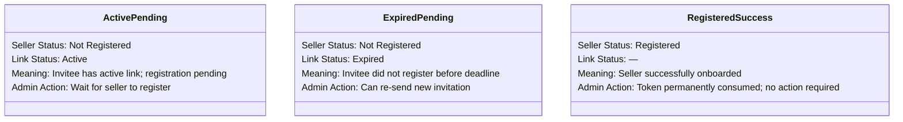

# Invitation Management Grid

The **Seller Invitation List** provides store administrators with a centralized dashboard to track all sent invitations, inspect invite statuses, monitor link expirations, and perform bulk operations.

---

## Navigating to the Invitation Grid

In the Magento Admin Panel, navigate to:

```text
Marketplace > Seller Invitation > Invite Seller
```

This opens the administrative UI component grid (`sellerinvitation_invite_list`).

---

## Grid Columns & Indicators

The invitation grid displays comprehensive metadata for every invitation:

| Column Name | Database Field | Filter Type | Description |
|---|---|---|---|
| **ID** | `entity_id` | Text Range (From / To) | Unique auto-increment primary key of the invitation record. |
| **Name** | `name` | Text | Name of the invited recipient as entered by the administrator. |
| **Email** | `email` | Text | Recipient's email address. |
| **Invite Code** | `invite_code` | Text | The unique 16-character cryptographic token assigned to the invitation. |
| **Seller Status** | `status` | Select Dropdown | Current seller onboarding status: <br>• **Registered (1)**: The invitee completed seller registration. <br>• **Not Registered (0)**: The invitee has not yet completed registration. |
| **Link Status** | `created_at` (computed) | — | Real-time link validity indicator: <br>• **Active**: The invitation link is valid and within its expiration window. <br>• **Expired**: The link has exceeded the configured Link Expiry Time. |


---

## Understanding Status Combinations

The combination of **Seller Status** and **Link Status** informs administrative actions:



### 1. Active & Not Registered
The invitation is live and pending. If the admin tries to send another invite to this email, the system safely suppresses duplicate invitations.

### 2. Expired & Not Registered
The invitee did not complete registration within the specified expiration hours. The token is invalidated. The admin can now click **Send Invite** to issue a brand new invitation to the recipient.

### 3. Registered
The merchant completed sign-up, shop URL validation, and profile creation. The token cannot be used again.

---

## Mass Actions: Mass Delete

Administrators can delete stale, expired, or unwanted invitation records:

1. Select individual checkboxes next to the invitations you wish to remove, or use the mass-selection menu to select **All** or **Visible**.
2. Open the **Actions** dropdown menu in the upper-left of the grid.
3. Select **Delete**.
4. Confirm the prompt: *"Delete selected items?"*.
5. The system permanently purges the selected records from `wk_mp_invitation` and presents a success message:
   ```text
   "Total of X record(s) were deleted."
   ```

---

## Grid Controls & Customization

The invitation list includes standard Magento UI component capabilities:

- **Search & Filters**: Quickly filter records by Recipient Name, Email, Status, or ID range.
- **Bookmarks**: Save custom filter configurations and default grid views.
- **Columns Control**: Show or hide specific columns based on workflow preference.
- **Sticky Header**: Keep column headings and action buttons visible while scrolling through records.
- **Pagination**: View 20, 30, 50, 100, or 200 records per page.

::: tip Next Step
Explore how the storefront behaves during merchant sign-up in [Seller Registration Flow](/configuration/seller-registration).
:::
