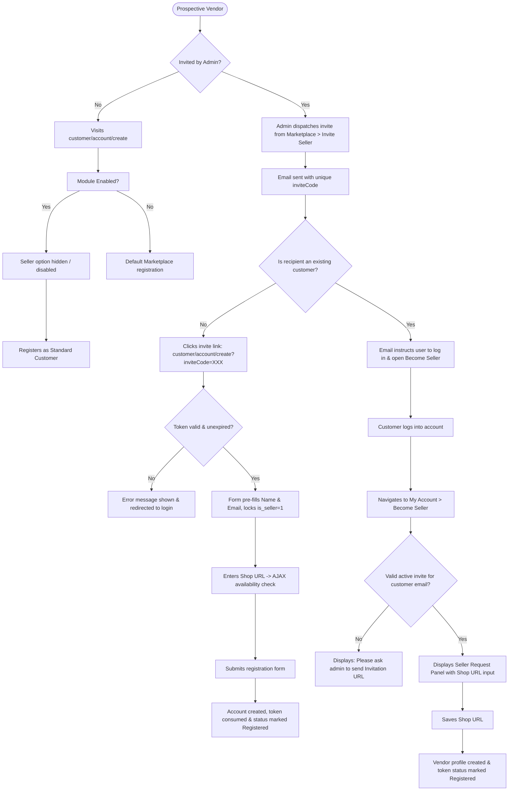
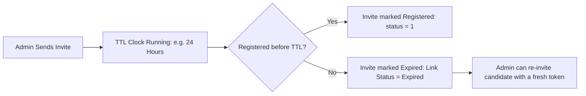

# Module Overview & Workflow

The **Webkul Marketplace Seller Invitation for Magento 2** extension transforms standard marketplace registration into an administrative, invite-controlled onboarding workflow. This page details the end-to-end lifecycle for store administrators, prospective new sellers, and existing retail customers.

---

## High-Level Architecture Workflow

The following flowchart illustrates how the invitation system manages public visitors, invited candidates, and existing registered customers:

---

## The Four Core Phases of the Extension

### Phase 1: Invitation Dispatch & Security Hashing

When the administrator creates an invitation under **Marketplace → Seller Invitation → Invite Seller → Send Invite**:

1. **Input Normalization**: Recipient name and description are sanitized (`strip_tags`) to neutralize potential script injections.
2. **Rate Limiting & Duplicate Check**:
   - The system computes a SHA-256 hash of the payload (`hash('sha256')`).
   - If an identical request is submitted within 60 seconds, it is rejected as a duplicate.
   - Remote IP addresses are tracked in Magento's cache backend; submissions exceeding **5 requests per minute** are temporarily blocked.
3. **Token Generation**: A unique 16-character alphanumeric string is generated using Magento's cryptographically secure random generator (`Random::getRandomString(16)`). The database enforces a `UNIQUE` constraint on the `invite_code` column in the `wk_mp_invitation` table.
4. **Email Dispatch**: An automated transactional email is routed via `TransportBuilder` to the recipient.

---

## Phase 2: Link Expiration Lifecycle

The extension provides a configurable Time-To-Live (TTL) for every invitation:

- When **Enable Link Expiry** is enabled (`marketplace/sellerinvitation/link_expiry_status = 1`), each link remains active for the configured number of hours (`marketplace/sellerinvitation/link_expiry`).
- If an invitee attempts to register using an expired link, Magento's observer intercepts the request and issues an informative error notice: *"Invitation Code Expired. Please contact admin."*
- If the administrator attempts to invite an email address with an active, unexpired pending invitation, the system prevents duplicate tokens by warning: *"Invitation code already sent. You will send invitation link again after link expired"*.
- Once the link expires, the administrator can re-send a fresh invitation link to that same recipient.

---

## Phase 3: New Vendor Registration Journey

For candidates who do not yet have an account on the store:

1. The candidate clicks the email link: `https://<store-domain>/customer/account/create/?inviteCode=<16_char_token>`.
2. Magento's `SellerRegisterBefore` observer executes:
   - Validates the `inviteCode` in the `wk_mp_invitation` table.
   - Ensures `status == 0` (token has not already been used).
   - Validates that the link has not expired.
   - Automatically injects the candidate's name and email into customer session form data (`customer_form_data`).
3. The registration page loads with the candidate's Name and Email pre-filled.
4. The hidden field `is_seller = 1` is injected, automatically activating marketplace seller registration.
5. The **Shop URL** input displays with a live AJAX validator (`Webkul_SellerInvitation/js/verifySellerShop`). As the candidate types, the system checks whether the desired store URL is available.
6. When the registration form is submitted:
   - `CheckCustomerBeforeSave` verifies that the submitted email matches the invitation code.
   - `CustomerRegisterSuccessObserver` marks the invitation record in `wk_mp_invitation` as `status = 1` (*Registered*).
   - The token can never be reused.

---

## Phase 4: Existing Customer Onboarding

For merchants who previously registered as regular customers:

1. When the administrator sends an invitation to an existing customer's email address, the system detects their registered status.
2. The generated email directs them: *"You are already registered on website, please login and goto My Account section then click on to Become seller menu to register as a seller"*.
3. The customer logs into their account and navigates to **My Account → Become Seller** (`marketplace/account/becomeseller`).
4. The template verifies whether an active, valid invitation token exists for their customer email:
   - **If no invite or expired**: The panel displays: *"Please ask admin to send Invitation URL to register as a seller."*
   - **If valid active invite**: The **Seller Request Panel** renders with the Shop URL input and the hidden `invitation_code`.
5. Upon saving the Shop URL, the `BecomeSellerPostPlugin` updates the invitation record to `status = 1` (*Registered*).

---

## Default Marketplace vs. Seller Invitation Enabled

| Feature | Standard Marketplace | With Seller Invitation Enabled |
|---|---|---|
| **Public Seller Sign-Up** | Anyone can select "Do You Want To Become A Seller / Vendor" | Only candidates with a valid `inviteCode` can become sellers |
| **Pre-filled Credentials** | Prospective sellers must type everything manually | Name and Email automatically pre-populate from invitation |
| **Existing Customer Upgrade** | Any customer can open "Become Seller" and request shop approval | Only customers with an active invitation can submit shop requests |
| **Invite Expiration Control** | Not supported | Admin can set link expiration in hours and resend after expiry |
| **Admin Onboarding Grid** | Only shows approved/unapproved registered sellers | Tracks all dispatched invitations, link states, and registration conversions |

::: tip Next Step
Configure extension options in [Configuration Settings](/configuration/settings).
:::
