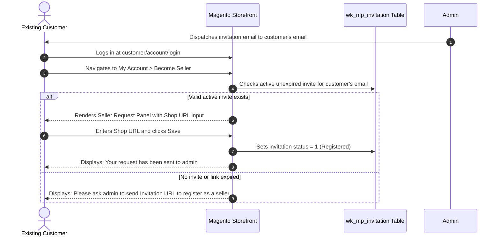

# Seller Registration Flow

This page details the storefront experience and technical lifecycle across all registration scenarios: general public visitors, invited new merchants, and existing registered customers.

---

## Scenario A: General Public Access (Module Enabled)

When the Seller Invitation module is enabled (`marketplace/sellerinvitation/status = 1`):

1. A visitor navigates to the customer registration page (`customer/account/create/`).
2. The template layout override suppresses the standard Webkul Marketplace prompt:
   - *"Do You Want To Become A Seller / Vendor?"* radio options are **hidden**.
3. The visitor fills out first name, last name, email address, and password.
4. The visitor is registered strictly as a **Standard Retail Customer**.
5. No marketplace seller profile is created.

---

## Scenario B: New Vendor Registration via Invite Link

When a prospective vendor receives an invitation email, they click the **Register Now** call-to-action button containing their unique invitation code:


```text
https://<store-domain>/customer/account/create/?inviteCode=aBcDeF1234567890
```

### 1. Link Validation & Form Pre-population

Before rendering the page, the `SellerRegisterBefore` observer validates the request:

- Checks if `inviteCode` exists in `wk_mp_invitation`.
- Verifies that `status == 0` (token has not been previously consumed).
- If Link Expiration is enabled, calculates whether the elapsed time is within `link_expiry` hours.
- If valid, the system retrieves the `name` and `email` associated with that invitation code and pre-populates the registration form:
  - First Name: Populated from invitation name.
  - Email Address: Populated from invitation email.
- Injects a hidden parameter:
  ```html
  <input type="hidden" id="wantpartner" class="wantpartner" name="is_seller" value="1" />
  <input type="hidden" name="inviteCode" value="aBcDeF1234567890" />
  ```


### 2. Live AJAX Shop URL Verification

The **Shop URL** input field automatically renders on the registration form:

- As the vendor types their desired shop handle (e.g., `modern-crafts`), the JavaScript component (`Webkul_SellerInvitation/js/verifySellerShop`) sends asynchronous verification queries to `marketplace/seller/usernameverify`.
- A loading spinner displays while checking availability.
- Dynamic feedback appears in real time:
  - **Available**: *"Congratulations! Shop name is available."* (Green highlight; submit button remains enabled).
  - **Unavailable**: *"Sorry! But this shop name is not available, please set another shop name."* (Red highlight; submit button is temporarily disabled).


### 3. Hyvä Theme Storefront Support

The module is also fully compatible with stores running the **Hyvä Theme**. When an invitee accesses the invitation link on a Hyvä storefront, the modern Alpine.js / Tailwind CSS registration layout seamlessly renders the pre-populated name and email, alongside the Shop URL verification interface:


### 4. Submission & Security Validation

When the vendor submits the registration form:

1. **Email Integrity Check (`CheckCustomerBeforeSave`)**:
   - The observer checks that the submitted email exactly matches the invitation record tied to `inviteCode`.
   - If a malicious user attempts to alter the pre-filled email address to another account, the submission is halted:
     ```text
     "This invite Code belong to another Email ID, please check your mail"
     ```
2. **Account Creation**: Magento registers the customer and initiates Webkul Marketplace seller creation.
3. **Token Invalidation (`CustomerRegisterSuccessObserver`)**:
   - The observer updates the matching row in `wk_mp_invitation`:
     ```php
     $dataModel->setStatus(1);
     $this->invitationDataRepo->save($dataModel);
     ```
   - The token status is permanently converted to **Registered (1)**.
   - Any future attempt to register with this token produces:
     ```text
     "Invalid Invitation Code for Seller Registration."
     ```

---

## Scenario C: Existing Customer Account Upgrade

For prospective sellers who already have a customer account on the store, they receive an invitation email directing them to log in to their existing account rather than registering a new one:




### 1. Accessing the "Become Seller" Panel

When an existing customer logs in and visits **My Account → Become Seller** (`marketplace/account/becomeseller`):

- The template (`account/becomeseller.phtml`) invokes `checkInvitationCodeExpired()`:
  - Fetches the customer's email from the active session.
  - Checks `wk_mp_invitation` for a matching record.
  - If no invitation exists or the invitation link has expired:
    ```html
    <div class="wk-invite-seller">
        <span>Please ask admin to send Invitation URL to register as a seller.</span>
    </div>
    ```
    The submission form is suppressed, preventing unauthorized seller requests.
  - If a valid, unexpired invitation exists:
    The **Seller Request Panel** displays the Shop URL input with live username verification and injects the customer's active `invitation_code` as a hidden field.

### 2. Processing the Request

When the customer clicks **Save**:

- Webkul Marketplace's `BecomesellerPost` controller handles seller profile generation.
- The `BecomeSellerPostPlugin` executes:
  - Retrieves `invitation_code` from post data.
  - Updates the corresponding record in `wk_mp_invitation` to `status = 1`.
- The customer is now registered as a marketplace vendor (pending admin approval based on store marketplace settings).

::: tip Next Step
Review complete version update details in [Release Notes & Changelog](/configuration/changelog).
:::
