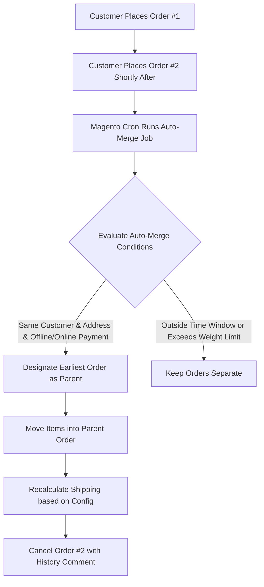

# Auto Merge Order

The **Auto Merge Order** feature enables automated background consolidation of qualifying customer orders, minimizing manual administrative tasks and optimizing warehouse dispatches.

---

## Configuration Settings

Navigate to **Stores > Configuration > Webkul > Split And Merge Order > Auto Merge Order**.


| Setting Field | Description | Options / Behavior |
| :--- | :--- | :--- |
| **Enable Auto Merge** | Enable or disable the automated order merging cron background job. | **Yes** / **No** |
| **Auto Merge Time Interval / Window** | Define the time window (in minutes or hours) within which multiple orders placed by the same customer qualify for auto-merging. | Positive integer (e.g., within 60 minutes or same calendar day). |
| **Shipping Charge Calculation** | Determines how shipping fees are handled when orders are automatically merged. | • **Merge All Shipping Charges:** Adds together the shipping fees of all qualifying orders.<br>• **Use Parent Order Shipping:** Retains only the shipping fee of the oldest/primary order.<br>• **Custom Shipping Charges:** Applies a predefined fixed rate. |

---

## How Auto-Merge Works



### Background Processing Requirements:
1. Ensure the standard Magento cron daemon is active on the server:
   ```bash
   php bin/magento cron:run
   ```
2. The cron job periodically queries pending orders that meet:
   - Same registered customer ID or guest email and shipping address.
   - Identical payment method type.
   - Placed within the configured auto-merge time interval.
   - Within configured weight and maximum total limits.
