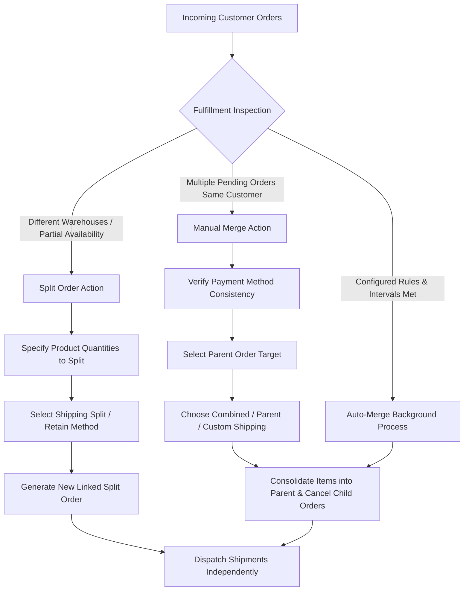

# Introduction

**Magento 2 Order Split & Merge** extension allows store administrators to seamlessly split multi-item orders and merge separate customer orders into unified shipments. By integrating intelligent order splitting and merging capabilities into the Magento 2 sales infrastructure, store merchants can streamline fulfillment, cut excessive shipping charges, and utilize Magento 2 as a robust **Order Management System (OMS)**.

Furthermore, the module is purpose-built for store owners operating multiple warehouses or fulfillment centers. When an order contains items stocked across distinct warehouse locations, the administrator can split the order into individual consignments, allowing each facility to fulfill and ship items independently without logistical delays.

---

## Architecture & Order Operations Workflow

The diagram below demonstrates how the administrator manages orders across splitting, merging, and automated fulfillment pathways:

---

## Critical Rules & Guardrails

::: warning Note on Order Status Restrictions
- **Payment Method Consistency:** Orders placed with either offline or online payment methods can be merged, provided all orders selected for merging share the **same payment method** (either all Offline or all Online).
- **Split Restrictions:** Orders placed with **offline payment methods** can only be split.
- **Invoiced Orders:** Once an invoice has been generated for an order, that order **cannot be split**.
- **Shipped Orders:** If a shipment has already been generated for an order, it **cannot be merged or split**.
:::

---

## Key Benefits of Split & Merge Orders

- **Reduced Shipping Expenditures:** Avoid unnecessary courier and packaging overheads by combining multiple orders going to the same customer into a single consolidated shipment.
- **Automated Order Merging:** Save administrative time and eliminate repetitive manual reviews by automatically merging qualifying orders based on custom scheduling rules.
- **Multi-Warehouse Alignment:** Split large orders based on warehouse availability, ensuring items are dispatched quickly from the nearest fulfillment hub.
- **Partial Fulfillment Efficiency:** Eliminate customer waiting times by splitting out available items for immediate dispatch while awaiting backordered products.
- **Simplified Refund Management:** Isolate problematic or cancelled items into separate child orders, making partial credit memos and returns frictionless.
- **Standard Packaging Compliance:** Divide voluminous orders into standardized box sizes to fit carrier size and weight constraints.
- **Cross-Account Consolidation:** Merge orders placed across different customer profiles into a single primary customer order when required.
- **Online Payment Support:** Merge orders placed through online payment gateways safely while maintaining financial ledger integrity.

---

## Core Extension Features

- **Manual Order Merging:** Merge two or more pending orders directly from the Magento Admin Sales Order grid.
- **Flexible Order Splitting:** Split specific quantities of individual products out of an existing order to create child orders.
- **Automatic Order Merge:** Enable background cron-based order merging based on customer identity and customizable scheduling windows.
- **Versatile Shipping Cost Allocation:**
  - Split original shipping costs proportionally across split orders.
  - Retain full shipping charge on the parent order only.
  - Apply custom fixed shipping charges to newly created split orders.
  - Consolidate all shipping fees when merging orders.
  - Apply parent-only shipping charges or custom fees to merged consignments.
- **Parent Order Designation:** Choose which order acts as the primary master order during manual merge operations.
- **GraphQL API Support:** Supports automated order merging via GraphQL API for mobile apps and headless storefronts.
- **Complete Order Audit Trails:** Automatically logs administrative comments detailing parent-child relationship history on order detail pages.
