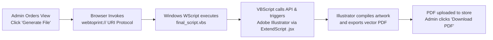

# Adobe Illustrator Setup & PDF Generation

The **Web To Print** extension includes built-in desktop integration with **Adobe Illustrator**. This bridge allows store administrators and print operators to transform customer web designs into commercial-grade vector Adobe Illustrator (`.ai`) files and export high-resolution print-ready PDFs with a single click.

---

## How the Desktop Illustrator Bridge Works



1. The store administrator clicks **Generate File** on the order view in Magento Admin.
2. The browser invokes a registered Windows protocol: `webtoprint://`.
3. The Windows Script Host executes `final_script.vbs`.
4. The script fetches customer design coordinates and assets via Magento REST APIs, feeds them into `generateAIFile.jsx`, and instructs Adobe Illustrator to assemble the artboard and export a vector PDF.
5. The administrator clicks **Download PDF** to send the prepress file directly to production digital printers.

---

## Phase 1: Windows Registry Protocol Setup

To enable your browser to communicate with Adobe Illustrator, register the `webtoprint` protocol on your Windows workstation.

### Step 1: Open Registry Editor
Press `Win + R`, type `regedit`, and select **Run as administrator**.


### Step 2: Navigate to `HKEY_CLASSES_ROOT`
Under `HKEY_CLASSES_ROOT`, right-click and choose **New** > **Key**. Name the key `webtoprint`.


### Step 3: Add Protocol Strings
1. Right-click inside `webtoprint` and select **New** > **String Value**.
2. Name the string: `URL PROTOCOL`.
3. Double-click the `(Default)` string and set its **Value Data** to: `URL:Webtoprint AI Protocol`.


### Step 4: Create Key Hierarchy: `shell` > `open` > `command`
1. Right-click `webtoprint` > **New** > **Key** > name it `shell`.
2. Select `shell`, double-click `(Default)` and set value to `open`.
3. Right-click `shell` > **New** > **Key** > name it `open`.
4. Select `open`, double-click `(Default)` and set value to `&Open`.
5. Right-click `open` > **New** > **Key** > name it `command`.


### Step 5: Configure Command String
Under the `command` key, double-click `(Default)` and enter the execution command:

```text
WScript "C:\Users\<YourUser>\Desktop\adobe_Illustrator\final_script.vbs" "%1"
```

::: warning Straight Quotes Mandatory
Ensure the quotation marks used in the Value Data string are straight ASCII quotes (`"`) rather than typographic curly quotes (`“` or `”`).
:::


---

## Phase 2: Script Files Configuration

Create a working directory on your local machine (e.g., `C:\Users\webkul\Desktop\adobe_Illustrator\`) with the following structure:

```text
C:\Users\webkul\Desktop\adobe_Illustrator\
├── images/             (directory for downloaded asset layers)
├── pdf/                (directory where output PDFs are saved)
├── generateAIFile.jsx  (ExtendScript file executed by Illustrator)
└── final_script.vbs    (VBScript orchestration script)
```

### Editing `generateAIFile.jsx`
Open `generateAIFile.jsx` in your code editor and update the `basefilepath` variable to match your local folder:

```javascript
var basefilepath = "/C/Users/webkul/Desktop/adobe_Illustrator/";
```

### Editing `final_script.vbs`
Open `final_script.vbs` and configure your store URL and local base directory:

```vbscript
apiURL = "https://your-magento-store.com/"
fileBasePath = "C:\Users\webkul\Desktop\adobe_Illustrator\"
```


---

## Phase 3: Order Fulfillment & PDF Generation Workflow

Once configured, processing print orders is completely turnkey:

1. In the Magento Admin Panel, navigate to **Sales** > **Orders** and open an order containing Web To Print merchandise.
2. Scroll to the bottom order detail section to review the customized items.


### Downloading Raw Design Assets (ZIP)
Click **Download Zip** to download a compressed archive containing all individual graphic layers, uploaded user artwork, and rendered front/back composites.


### Triggering Automated PDF Generation
1. Click the **Generate File** button.
2. The browser prompts you to open the `webtoprint` protocol handler. Accept the prompt.
3. Adobe Illustrator opens in the background, renders the vectors and text, and compiles the PDF document.


4. Once rendering completes, the status on the order updates. Click **Download PDF** to save the production-ready PDF file.


::: tip Hardware & Software Advice
Adobe Illustrator must be installed and active on the workstation handling print fulfillment. For large multi-page vector artwork, keep Illustrator updated to the latest Creative Cloud release.
:::
