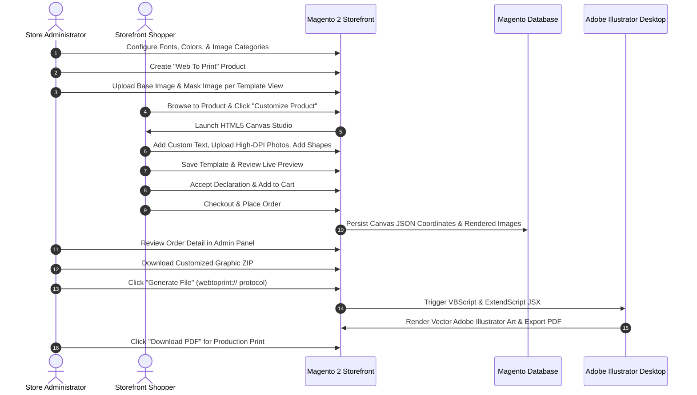

# Module Overview & Workflow

The **Webkul Web To Print** extension connects digital e-commerce merchandising with physical print manufacturing. It replaces static product presentation with an interactive HTML5 studio where shoppers personalize their products before purchasing.

---

## Core Concepts & Terminology

Understanding the core mechanics of Web To Print ensures optimal design setup and print accuracy:

| Term | Concept | Description |
|---|---|---|
| **WTP Product Type** | Catalog Entity | A dedicated Magento product type (`webtoprint`) featuring custom pricing indexers, refundable flags, and canvas hooks. |
| **Base Image** | Background Graphic | The photorealistic background showing the physical item (e.g., a white t-shirt, ceramic mug, or blank canvas bag). |
| **Mask Image** | Printable Canvas Boundary | A transparent PNG overlay defining the exact rectangular or contour area where customization and printing occur. Customer graphics are bounded inside this mask. |
| **Template View** | Multi-Angle View | An individual customizable face of a product (e.g., Front View, Back View, Left Sleeve, Right Sleeve). A single product can feature unlimited template views. |
| **Canvas Resolution & DPI** | Print Quality Standard | Minimum pixel width/height and Dots Per Inch (DPI) thresholds verified during customer uploads to prevent pixellated prints. |
| **Vector AI Script** | Prepress Automation | Automated Adobe Illustrator integration that renders high-resolution vector and raster assets onto production print sheets as vector PDFs. |

---

## End-to-End Workflow Diagram

The diagram below illustrates the complete lifecycle of a Web To Print product, from administrative setup to final print-ready PDF export:

---

## Administrative Navigation Structure

When the module is active, the Magento Admin sidebar displays the dedicated **Web To Print** menu:

- **Image Category**: Organize clip art and graphic libraries into structured groupings (e.g., Sports, Nature, Holidays).
- **Images**: Upload raster or vector graphics that customers can add directly to their canvas.
- **WTP Fonts**: Upload `.ttf` or `.otf` font families available in the text editor typography selector.
- **WTP Color**: Register preset brand color swatches for text, backgrounds, and shape outlines.
- **Support & Help**: Direct links to documentation, extension updates, and Webkul support tickets.

In the following sections, we will explore the detailed configuration and step-by-step setup for each component.
