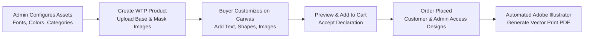

# Introduction

**Webkul Web To Print for Magento 2 (Adobe Commerce)** transforms your digital storefront into an interactive design and print-on-demand studio. It empowers your customers to personalize products—such as apparel, t-shirts, coffee mugs, phone cases, business cards, signs, and promotional merchandise—directly within the browser using a powerful HTML5 canvas editor.

Store owners can introduce custom fonts, color palettes, vector shapes, clip arts, and pre-designed multi-view templates (front, back, left, and right views). In turn, customers can format text, upload high-resolution artwork with automatic DPI validation, manipulate layers, and preview their bespoke creations before placing orders. For print fulfillment, administrators can export high-resolution design packages and trigger automated **Adobe Illustrator** integration to compile print-ready vector PDF files.

::: tip Latest Version Compatibility
The latest release (**v5.0.5**) is fully tested and compatible with **Magento ^2.4.9**, **PHP 8.2 - 8.5**, and modern storefront architectures. It features mass-management for assets, dynamic variant price updates, DPI validation with PHP Imagick, and automated desktop Adobe Illustrator scripting. For version history, see the [Release Notes & Changelog](/configuration/changelog).
:::

---

## Why Use Web To Print for Your Online Store?

Offering print-on-demand and customizable products gives your brand a decisive competitive advantage:

1. **Higher Conversion Rates & Engagement**: Interactive product visualizers increase on-page time and buyer confidence by letting customers craft their own designs in real time.
2. **Reduced Return Rates**: Customers see an exact visual preview of their personalized item—including custom text, alignment, and graphic placement—before checking out, minimizing order disputes.
3. **Streamlined Print Fulfillment**: Eliminates tedious back-and-forth email proofs. Store administrators receive exact design coordinates, uploaded artwork, and automated Adobe Illustrator PDF outputs ready for production presses.
4. **Flexible Product Catalog**: Introduce dedicated *Web To Print* product types alongside standard simple or configurable catalog items without disturbing existing inventory workflows.

---

## How Web To Print Works

The **Webkul Web To Print** extension provides an end-to-end personalization and prepress fulfillment workflow:

- **Dedicated Product Type**: Introduces the `webtoprint` product type in the Magento catalog, complete with custom price indexers and refundable attribute handling.
- **Multi-View Template Architecture**: Configure multiple customizable views (e.g., Front View, Back View, Sleeve) with distinct base photos and transparent mask layers that isolate custom design zones.
- **Rich Asset Management**:
  - **Font Library**: Upload TrueType (.ttf) or OpenType (.otf) font packages for typography styling.
  - **Color Palettes**: Curate pre-defined brand color swatches alongside interactive HEX color pickers.
  - **Clip Art & Graphic Categories**: Organize stock imagery and graphics by category for buyers to drop onto their canvas.
- **Image Quality & DPI Guardrails**: Configure minimum canvas dimensions, upload dimensions, and minimum DPI (Dots Per Inch) thresholds via PHP Imagick to prevent low-resolution, blurry prints.
- **Customer Canvas Studio**: Features intuitive drag-and-drop manipulation, rotation, text curvature, layer sorting, shape fills, stroke width adjustments, and zoom sliders.
- **Prepress & Adobe Illustrator Automation**: Admin order views allow downloading all customized image assets as a `.zip` archive or dispatching a single-click script to Adobe Illustrator via the `webtoprint://` protocol to generate production-grade PDFs.

---

## Key Features at a Glance

| Feature | Description |
|---|---|
| **Dedicated WTP Product Type** | Native Magento 2 product type designed specifically for customizable merchandise. |
| **Multi-View Templates** | Support for multiple design areas per item (e.g., front, back, collar, side). |
| **Mask Image Isolation** | Transparent mask overlays ensure customer artwork remains strictly within printable boundaries. |
| **Interactive Canvas Studio** | Full-featured HTML5 canvas supporting text formatting, shapes, and custom graphic uploads. |
| **Font Management** | Upload and assign custom font files (`.ttf`, `.otf`) to empower distinct typographic designs. |
| **Color Palettes & HEX Picker** | Offer admin-curated color swatches as well as custom HEX code inputs for shapes and text. |
| **DPI & Dimension Validation** | Prevent poor quality output by enforcing minimum image resolution (DPI) and pixel dimensions. |
| **Real-Time Price Updates** | Seamlessly updates pricing when switching variants or selecting complex customization options. |
| **Order Confirmation Previews** | Customized visuals are captured as dynamic product thumbnails in cart, checkout, and order histories. |
| **Customer Image Downloads** | Customers can download their personalized design graphics directly from their account order details. |
| **Adobe Illustrator Protocol** | Windows desktop protocol (`webtoprint://`) integration for automated `.ai` file processing. |
| **Vector PDF Generation** | One-click generation and download of print-ready vector PDF files from the Magento admin panel. |
| **Hyvä Theme Compatibility** | Seamless compatibility with Hyvä Themes using Alpine.js and Tailwind CSS for superior frontend speed and Core Web Vitals. |
| **Multi-Language & i18n Ready** | Fully translatable interface via CSV dictionaries (`en_US.csv`, `ar_SA.csv`, etc.). |
